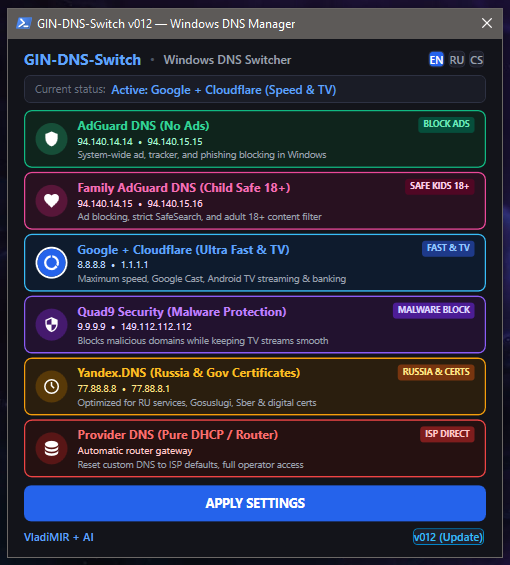

# 🌐 GIN-DNS-Switch `v012`

<div align="center">

[-0078D6?style=for-the-badge&logo=windows&logoColor=white)](https://github.com/GinCz/Windows_scripts)
[](https://github.com/GinCz/Windows_scripts)
[-00E676?style=for-the-badge&logo=github&logoColor=white)](https://github.com/GinCz/Windows_scripts/raw/main/GIN-DNS-Switch/GIN-DNS-Switch_v012_Setup.exe)
[-0284C7?style=for-the-badge&logo=speedtest&logoColor=white)](https://github.com/GinCz/Windows_scripts)
[](https://github.com/GinCz/Windows_scripts)
[](LICENSE)

<br/>

### ⚡ Smart High-Performance DNS Profile Manager for Windows
**1-Click Switching • Physical Adapter Auto-Detection • VirtualBox Exclusion • Trilingual UI • Zero Memory**

<br/>

[](https://github.com/GinCz/Windows_scripts/raw/main/GIN-DNS-Switch/GIN-DNS-Switch_v012_Setup.exe)
[-0284C7?style=for-the-badge&logo=github&logoColor=white)](https://github.com/GinCz/Windows_scripts/raw/main/Windows/GIN-DNS-Switch/GIN-DNS-Switch_v012_Setup.exe)
[](https://github.com/GinCz/Windows_scripts/tree/main/GIN-DNS-Switch)

</div>

---

## 🏷️ Tags & Topic Keywords

```
#DNS #Windows10 #Windows11 #AdBlock #AdGuard #Cloudflare #GoogleDNS #Quad9 #YandexDNS #Privacy #CyberSecurity #WinAPI #Network #DHCP #OpenSource #SysAdmin #DevOps #SpeedTest #FamilySafety #SafeSearch #ParentalControl #Gaming #Streaming #AndroidTV #GoogleCast
```

---

## 📸 Application Screenshot & Interface

<div align="center">
  
  <p><em>Modern, dark-themed WPF control panel with real-time active DNS detection, vibrant neon card status, trilingual localization (EN / RU / CS), and instant 1-click apply.</em></p>
</div>

---

## 💡 Overview

**GIN-DNS-Switch** is a standalone, ultra-fast Windows DNS profile manager engineered with a native dark-mode WPF GUI.

Changing DNS manually in Windows usually requires navigating through 5 layers of menus:  
`Settings / Control Panel ➔ Network Connections ➔ Adapter Properties ➔ Internet Protocol Version 4 (TCP/IPv4) ➔ Properties ➔ Use the following DNS server addresses`.

**GIN-DNS-Switch eliminates this friction permanently.** With a single click from your Desktop or Start Menu:
- Automatically detects your primary active physical network adapter (Realtek USB GbE, Intel PCIe LAN, Wi-Fi 6/6E/7).
- Applies your selected DNS profile across **IPv4 and IPv6** simultaneously using a **Triple-Engine architecture (WMI + NetTCPIP + Netsh)**.
- Flushes the Windows DNS resolver cache (`ipconfig /flushdns`) and refreshes dynamic registrations (`ipconfig /registerdns`).
- Shuts down cleanly with **0 MB residual RAM footprint** — zero background daemons, zero telemetry, zero bloat.

---

## 🛡️ 6 Curated High-Performance DNS Profiles

| Profile | Badge | IPv4 Primary / Secondary | IPv6 Primary / Secondary | Primary Use Case & Security Benefit |
|---|---|---|---|---|
| 🟢 **AdGuard DNS** | `BLOCK ADS` | `94.140.14.14`<br/>`94.140.15.15` | `2a10:50c0::ad1:ff`<br/>`2a10:50c0::ad2:ff` | **System-Wide Ad Blocking:** Eliminates banners, pop-ups, video ads, telemetry, and phishing domains across all Windows apps and browsers. |
| 🌸 **Family AdGuard DNS** | `SAFE KIDS 18+` | `94.140.14.15`<br/>`94.140.15.16` | `2a10:50c0::bad1:ff`<br/>`2a10:50c0::bad2:ff` | **Parental Control & SafeSearch:** Enforces strict SafeSearch (Google, Bing, Yandex, DuckDuckGo) and blocks adult/18+ content while filtering ads. |
| 🔵 **Google + Cloudflare** | `FAST & TV` | `8.8.8.8`<br/>`1.1.1.1` | `2001:4860:4860::8888`<br/>`2606:4700:4700::1111` | **Maximum Speed & TV Streaming:** Optimal routing, sub-10ms response time, 100% Google Cast & Android TV compatibility, unblocks banking & e-commerce. |
| 🟣 **Quad9 Security** | `MALWARE BLOCK` | `9.9.9.9`<br/>`149.112.112.112` | `2620:fe::fe`<br/>`2620:fe::9` | **Swiss Non-Profit Malware Protection:** Threat intelligence from 20+ vendors. Blocks botnets, ransomware & phishing without breaking ad-monetized streams. |
| 🟡 **Yandex.DNS** | `RUSSIA & CERTS` | `77.88.8.8`<br/>`77.88.8.1` | `2a02:6b8::feed:0ff`<br/>`2a02:6b8:0:1::feed:0ff` | **Russian Digital Certificates & Services:** Optimized for Gosuslugi, Sberbank, VTB, Federal Tax Service (nalog.gov.ru), and domestic TLS root certs. |
| 🔴 **Provider DNS** | `ISP DIRECT` | `Automatic (DHCP)` | `Automatic (DHCP)` | **Pure DHCP Gateway Reset:** Instantly clears custom DNS overrides and restores default router gateway for local NAS (Synology/QNAP), LAN printers & captive portals. |

---

## ✨ Key Features & Technical Innovations in `v012`

### 1. 🎯 Smart Physical Adapter Auto-Detection (`Get-PrimaryActiveAdapter`)
Many multi-adapter setups suffer from DNS switchers applying settings to inactive virtual interfaces (e.g. *VirtualBox Host-Only Ethernet Adapter*, *VMware Virtual Ethernet*, *Hyper-V vEthernet*, *WSL*, *ZeroTier*, or *WireGuard*).
- **v012 Solution:** Intelligently discovers the true physical network adapter routing outbound internet traffic (`0.0.0.0/0` default route) with `Virtual = $false`.
- The «⚙ Adapter Settings» button opens properties directly for your physical interface (e.g. *Realtek USB GbE Family Controller* or *Intel Ethernet Connection*) in Shell Namespace 49, bypassing all virtual noise.

### 2. ⚡ Triple-Engine DNS Application Pipeline
Traditional DNS scripts that rely solely on `netsh` or `Set-DnsClientServerAddress` frequently fail when executed under non-elevated threads or on external USB Ethernet adapters. **GIN-DNS-Switch** employs a 3-tier cascade:
1. **WMI (`Win32_NetworkAdapterConfiguration.SetDNSServerSearchOrder`)** — Hardware-level adapter configuration standard.
2. **NetTCPIP (`Set-DnsClientServerAddress`)** — Modern Windows networking profile stack for IPv4 and IPv6.
3. **Netsh Command Fallback (`netsh interface ipv4/ipv6 set dnsservers`)** — Direct low-level winsock binding.

### 3. 🔄 Continuous Profile Switching (No App Restarts)
In `v012`, opening adapter settings or switching between profile cards immediately cancels any pending auto-close countdown and keeps the **«APPLY SETTINGS»** button active. You can compare profiles, toggle AdGuard vs Cloudflare, and test different DNS providers in rapid succession without reopening the program.

### 4. 🌐 Trilingual Dynamic GUI (EN / RU / CS)
- One-click language switching between **English (`EN`, default)**, **Russian (`RU`)**, and **Czech (`CS`)**.
- User language preference is stored in the Windows Registry (`HKCU:\Software\GIN-DNS-Switch\Language`) and automatically restored upon next launch.
- All headers, card titles, badges, descriptions, tooltips, and status messages adapt instantaneously in memory without window flickering.

### 5. 🔍 Real-Time Active DNS State Detection
Upon launch, **GIN-DNS-Switch** queries the active adapter's DNS configuration, detects whether your current servers match any of the 6 profiles, and dynamically updates the top status bar:
- `Active: Google + Cloudflare (Speed & TV)`
- `Active: AdGuard DNS (No Ads)`
- `Active: Provider DNS (Pure DHCP / Router)`
- `Active: Custom DNS (X.X.X.X)`

### 6. 📉 Zero Background Process & Zero Idle RAM
Unlike competing tools that run permanent background tray services, **GIN-DNS-Switch** runs purely on demand. Once settings are applied and confirmed, the window closes cleanly and unloads all resources from memory (**0 MB residual RAM**).

---

## 🚀 Download & Installation

### Option 1: Standalone 1-Click Installer (Recommended)

1. Download [`GIN-DNS-Switch_v012_Setup.exe`](https://github.com/GinCz/Windows_scripts/raw/main/GIN-DNS-Switch/GIN-DNS-Switch_v012_Setup.exe).
2. Run the installer. It silently unpacks the application files to `C:\Program Files\GIN-DNS-Switch\`, creates Desktop and Start Menu shortcuts, registers the uninstaller in *Windows Programs & Features*, and launches the utility immediately.
3. Select your preferred DNS profile and click **«APPLY SETTINGS»**.

### Option 2: Portable Script Execution

Run directly from source without installing:

```cmd
:: Run with Administrator privileges
powershell -NoProfile -ExecutionPolicy Bypass -File "src\GIN-DNS-Switch.cmd"
```

### Option 3: Compile Setup from Source

Requirements: Go 1.22+ and MinGW-w64 (`x86_64-w64-mingw32-windres`).

```bash
# Clone the repository
git clone https://github.com/GinCz/Windows_scripts.git
cd Windows_scripts/GIN-DNS-Switch/src

# Build native uninstaller, compile PE resource, and generate GIN-DNS-Switch_v012_Setup.exe
./build_release.sh
```

---

## 🗑️ Clean Uninstallation

**GIN-DNS-Switch** includes a standalone native Go uninstaller (`Uninstall.exe`):
- Accessible via **Windows Settings ➔ Installed apps ➔ GIN-DNS-Switch ➔ Uninstall**.
- Copies itself to `%TEMP%`, cleanly unlinks all application files from `C:\Program Files\GIN-DNS-Switch\`, deletes registry keys (`HKLM` and `HKCU`), removes Desktop and Start Menu shortcuts, and self-deletes. Zero residue left behind.

---

## 📋 Version History

| Version | Date | Highlights |
|---|---|---|
| **`v012`** | **2026-11-08** | Physical adapter auto-detection (`Get-PrimaryActiveAdapter`); strict VirtualBox Host-Only exclusion; Shell Namespace 49 physical adapter properties launcher. |
| **`v011`** | **2026-11-08** | Fixed BtnApply re-enabling bug allowing unlimited consecutive profile switching; strictly single versioned installer layout. |
| **`v010`** | **2026-11-08** | English default installer with silent zero-popup install; neon card illumination; language persistence; 10s countdown with Adapter Settings button. |
| **`v008`** | **2026-11-08** | Embedded red uninstaller icon; compact single-line header; UI-thread sync updater; strict 6-card profile ordering. |
| **`v004`** | **2026-11-07** | Critical reliability release: Triple-Engine DNS pipeline (WMI + NetTCPIP + Netsh); native compiled Go uninstaller; in-process UAC check. |

---

## 👤 Author & Credits

- **Author:** Vladimir Bulantsev ([@GinCz ↗](https://github.com/GinCz)) & AI (`VladiMIR + AI`)
- **Main Author Page:** [https://github.com/GinCz/ ↗](https://github.com/GinCz/)
- **Repository:** [GitHub: Windows_scripts ↗](https://github.com/GinCz/Windows_scripts)
- **Direct Project Link:** [GIN-DNS-Switch ↗](https://github.com/GinCz/Windows_scripts/tree/main/GIN-DNS-Switch)
- **License:** Freeware (Free for personal and commercial use)
