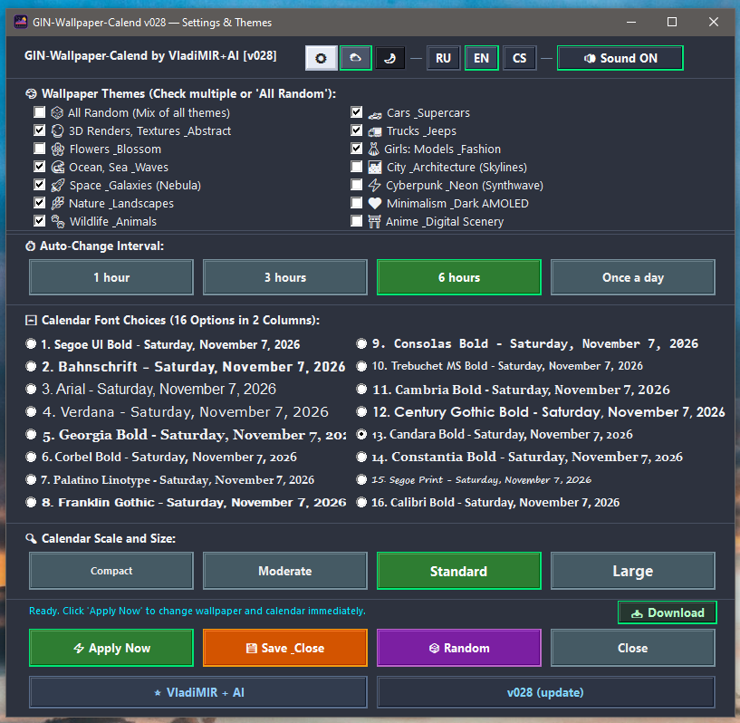

# 🖼️ GIN-Wallpaper-Calend `v028`

<div align="center">

[-0078D6?style=for-the-badge&logo=windows&logoColor=white)](https://github.com/GinCz/Windows_scripts)
[](https://go.dev/)
[](https://github.com/GinCz/Windows_scripts)
[](https://wallhaven.cc/)
[](LICENSE)

<br/>

### 🌟 Smart Desktop Wallpaper Engine with Live Calendar HUD for Windows
**Lightweight • Native WinAPI • 4K UHD Wallhaven API • Anti-Duplication • Trilingual • Ultra-Low Memory**

<br/>

[](https://github.com/GinCz/Windows_scripts/raw/main/GIN-Wallpaper/GIN-Wallpaper-Calend_v028_Setup.exe)
[](https://wallhaven.cc/)
[](https://github.com/GinCz/Windows_scripts/tree/main/GIN-Wallpaper)

</div>

---

## 📸 Application Screenshot & Interface

<div align="center">
  
  <p><em>Modern, dark-themed WinAPI configuration panel with live typography previews, trilingual localization, and one-click wallpaper download.</em></p>
</div>

---

## 💡 Overview

**GIN-Wallpaper-Calend** is a standalone, ultra-lightweight Windows desktop tray utility that automatically downloads stunning, high-resolution Ultra HD wallpapers and composites an elegant, anti-aliased live calendar HUD onto your desktop.

Unlike bulky Electron- or Chromium-based wallpaper apps that consume 150–350 MB of RAM, **GIN-Wallpaper-Calend** is engineered in native Go and uses pure Windows GDI/WinAPI rendering with aggressive memory trimming, idling at just **~1.5 to 2.0 MB of RAM**.

---

## 🌐 Wallpaper Sources, API & Image Pipeline

### Where do the wallpapers come from?
- **Official API:** All wallpapers are fetched in real-time from **[Wallhaven.cc](https://wallhaven.cc/)** (`https://wallhaven.cc/api/v1/search`), the world's premier curated high-resolution wallpaper platform.
- **Strict Purity & SFW Filter:** Enforces `purity=100` (100% Safe For Work). Zero NSFW or vulgar content.
- **Categorization Engine:**
  - **General Themes & Vehicles (`100`):** Supercars, Trucks & Jeeps, Ocean, Space, Nature, Animals, City, Cyberpunk, 3D Fractals.
  - **Girls, Models & Fashion (`001` - People):** Dedicated to over 115,000+ professional studio portraits, runway models, and fine-art fashion photography.
  - **Anime (`010`):** Curated anime art and digital scenery.
- **Resolution & Quality:**
  - Minimum resolution requested: **Ultra HD 2K / 4K** (`atleast=2560x1440` up to `3840x2160`, `5120x2880` 5K, `7680x4320` 8K).
  - Raw downloaded image sizes: **3 MB to 15 MB** per pristine uncompressed JPEG/PNG photo.
  - Scale & Composite: The engine scales and crops the UHD photo pixel-perfect to your monitor's exact physical display resolution, overlays the calendar, and applies it to the Windows desktop at 98% JPEG quality (~1.5–3.5 MB on disk).

---

## ✨ Key Features in `v028`

| Feature | Description |
|---|---|
| 📂 **Smart Custom Pictures Auto-Detection** | Intelligently detects custom and relocated user Pictures folders (e.g. **`D:\docs\Pictures`**, `D:\DOCS\Pictures`), queries Windows Registry `User Shell Folders` (`My Pictures` and `Personal`), and Shell `SHGetFolderPathW` APIs. Auto-creates `Pictures` inside `D:\docs` if present. |
| 🔗 **Clickable Status Link with File Highlight** | The download confirmation status `✓ Saved to Pictures: <file>` is an interactive link with an `IDC_HAND` hover cursor. Clicking it immediately opens Windows File Explorer and selects the saved image (`explorer.exe /select,<path>`). |
| 📥 **Direct 4K Wallpaper Download** | Added a compact **`📥 Download`** button in Settings. Saves the pristine 4K UHD wallpaper (clean, without calendar HUD) into your Pictures folder sequentially numbered as `<category>_001.jpg`, `<category>_002.jpg`, etc. |
| 🚫 **Anti-Duplication History Cache** | Remembers a sliding window of the last 100 downloaded wallpaper IDs and queries Wallhaven with dynamic 6-character random seeds, completely eliminating repeats. |
| 🚙 **Trucks & Jeeps Precision** | Tuned category specifically for commercial trucks, pickups, Wranglers, 4x4 Jeeps, and big rigs with 100% vehicle accuracy. |
| 👗 **Girls: Models & Fashion** | Locked to Wallhaven `categories=001` (People category) with 115,000+ real portraits and fashion photography. Zero random tree fallbacks. |
| 🔤 **16 Typography Choices (No Clipping)** | 16 distinct font styles displayed in a balanced 2-column layout. Column 2 widened to 420px so long date samples like *Century Gothic Bold* never get truncated. |
| 🌐 **Trilingual Interface** | Instant switching between **English (`EN` default)**, **Russian (`RU`)**, and **Czech (`CS`)**. |
| ⏱️ **Configurable Intervals** | Automatic background wallpaper cycling: **1 hour**, **3 hours**, **6 hours**, or **Once a day**. |
| 💧 **Gentle Organic Audio Feedback** | Velvet acoustic double bloop (220–360 Hz) on wallpaper changes and saves; optional one-click mute button. |
| 📉 **Ultra-Low Memory Footprint** | Native WinAPI memory trimming (`SetProcessWorkingSetSize` + `debug.FreeOSMemory`) drops idle RAM consumption to **~1.5–2 MB**. |
| 🪟 **Minimal & Silent Installer** | Ultra-clean prompt: `GIN-Wallpaper-Calend - Install?` [OK] [Cancel]. Uninstaller is 100% silent with 0 popups. |

---

## 🎨 14 Curated Wallpaper Categories

1. 🎲 **All Random (Mix)** — Randomly rotates through all categories.
2. 🔮 **3D Renders, Textures & Abstract** — Fractals, mathematical geometric renders, 3D textures.
3. 🌸 **Flowers & Blossom** — Macro floral photography, gardens, spring blossoms.
4. 🌊 **Ocean, Sea & Waves** — Tropical coastlines, turquoise waves, beach sunsets.
5. 🚀 **Space & Galaxies** — Deep space Hubble/James Webb nebula photography, planetary views.
6. 🌿 **Nature & Landscapes** — Mountains, alpine lakes, Nordic fjords, majestic vistas.
7. 🐾 **Wildlife & Animals** — Wild predators, birds, marine life, animal portraits.
8. 🏎️ **Cars & Supercars** — Hypercars, Italian exotics, sports cars, luxury vehicles.
9. 🚛 **Trucks & Jeeps** — Semi-trucks, American big rigs, 4x4 Jeeps, off-road overland rigs, pickups.
10. 👗 **Girls: Models & Fashion** — Aesthetic high-fashion photography, studio portraits, runway models (100% SFW).
11. 🌆 **City & Architecture** — World capitals, night skylines, modern architecture.
12. ⚡ **Cyberpunk & Neon** — Synthwave, retro-futuristic cityscapes, neon aesthetic.
13. 🖤 **Minimalism & Dark AMOLED** — Deep black wallpapers, low-key lighting, minimalist art.
14. ⛩️ **Anime & Digital Scenery** — Makoto Shinkai-style digital backgrounds, skies, anime scenery.

---

## 🔤 16 Calendar Font Options

Live preview available directly in the Settings window:

```
Left Column (Fonts 1–8):              Right Column (Fonts 9–16):
1. Segoe UI Bold                      9. Consolas Bold
2. Bahnschrift                        10. Trebuchet MS Bold
3. Arial                              11. Cambria Bold
4. Verdana                            12. Century Gothic Bold
5. Georgia Bold                       13. Candara Bold
6. Corbel Bold                        14. Constantia Bold
7. Palatino Linotype                  15. Segoe Print
8. Franklin Gothic                    16. Calibri Bold
```

---

## 🚀 Quick Start & Installation

### Option 1: Standalone Installer (Recommended)

1. Download [`GIN-Wallpaper-Calend_v028_Setup.exe`](https://github.com/GinCz/Windows_scripts/raw/main/GIN-Wallpaper/GIN-Wallpaper-Calend_v028_Setup.exe).
2. Run the executable.
3. Confirm the clean prompt: `GIN-Wallpaper-Calend - Install?` -> click **OK**.
4. The application starts immediately, adds an icon to the system tray, registers Windows autostart, and places a desktop shortcut.

### Option 2: Build from Source

Requirements: Go 1.22+ and MinGW-w64 (`x86_64-w64-mingw32-windres`).

```bash
# Clone the repository
git clone https://github.com/GinCz/Windows_scripts.git
cd Windows_scripts/GIN-Wallpaper/src

# Build all binaries (Uninstall.exe, Runner, and Standalone Setup)
./build_release.sh
```

---

## 🛠️ System Tray & Shortcuts

- **Double-click Tray Icon:** Instantly triggers a fresh 4K wallpaper download and calendar re-render.
- **Right-click Tray Icon:**
  - 🔄 **Change Wallpaper** — Immediate wallpaper cycle.
  - ⚙️ **Settings** — Opens the Settings window.
  - 📁 **Open Program Folder** — Reveals installation directory.
  - ℹ️ **v027 (Check for Updates)** — Checks GitHub for new releases.
  - ❌ **Exit** — Closes the applet cleanly.

---

## 📄 License & Credits

- **Author:** [Vladimir Bulantsev (GinCz) ↗](https://github.com/GinCz)
- **Wallpaper API:** [Wallhaven.cc ↗](https://wallhaven.cc/)
- **License:** MIT License. Free for personal and commercial use.
