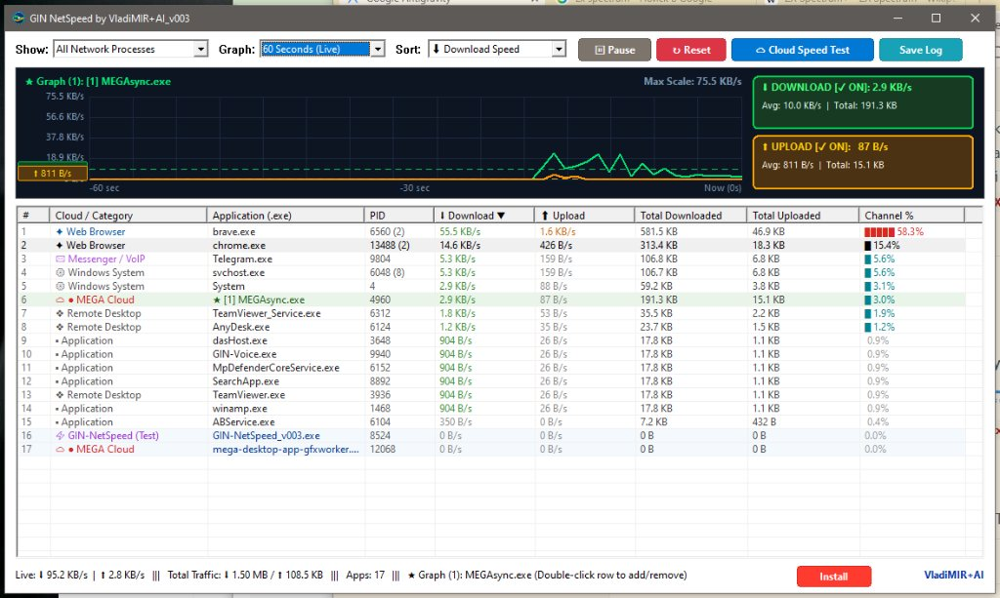

# 📊 GIN-NetSpeed: Live Per-Application Bandwidth Monitor, 15-Minute Multi-App Traffic Graph & Cloud Storage Speed Benchmark

<div align="center">

-0078D4?logo=windows&logoColor=white)


**A lightweight, 100% portable, open-source native Win32/GDI network bandwidth monitor and multi-cloud storage speed benchmark for Windows 10 & 11. Built as a fast, driverless, zero-bloat alternative to NetBalancer and Windows Task Manager.**

[⬇️ Download v003](#-quick-download--latest-release-v003) • [📸 Live Screenshot](#-interface-preview--live-telemetry) • [🌟 Key Features](#-key-features) • [☁️ Cloud Speed Benchmark](#️-built-in-cloud-engines-speed-benchmark) • [🛠️ Build from Source](#️-building-from-source-open-source) • [📜 Changelog](CHANGELOG.md)

---

`#GINNetSpeed` `#NetworkMonitor` `#BandwidthMonitor` `#NetBalancerAlternative` `#Windows11` `#Windows10` `#CloudBenchmark` `#MEGACloud` `#GoogleDrive` `#OneDrive` `#YandexDisk` `#MailRuCloud` `#Dropbox` `#GoLang` `#Win32API` `#GDI` `#PortableApp` `#OpenSource` `#SysAdmin` `#NetworkDiagnostics` `#TrafficAnalyzer` `#ZeroTelemetry`

</div>

---

## 📸 Interface Preview & Live Telemetry

<div align="center">


*GIN-NetSpeed v003 monitoring live per-application download/upload traffic, plotting `MEGAsync.exe` on the real-time graph with Y-axis speed markings, horizontal average speed lines, left-side numerical average callout badges, and interactive Download/Upload toggle cards.*

</div>

---

## 🚀 Quick Download & Latest Release (v003)

<div align="center">

### 🌐 [⬇️ Click Here to Download GIN-NetSpeed.exe (v003)](https://github.com/GinCz/Windows_scripts/raw/main/Windows/GIN-NetSpeed/GIN-NetSpeed.exe)
*Single standalone 64-bit portable executable (4.8 MB) • Zero external dependencies • Zero background services on exit*

</div>

### ⚡ 1-Click PowerShell Launch
Copy and paste into Windows PowerShell to download and launch immediately:
```powershell
Invoke-WebRequest -Uri "https://github.com/GinCz/Windows_scripts/raw/main/Windows/GIN-NetSpeed/GIN-NetSpeed.exe" -OutFile "$env:USERPROFILE\Desktop\GIN-NetSpeed.exe"; Start-Process "$env:USERPROFILE\Desktop\GIN-NetSpeed.exe"
```

---

## 🌟 Key Features

### 📈 1. Interactive 15-Minute Multi-Application Rolling Graph
* **Clean Standby by Default:** Starts with an empty graph canvas so you only plot the exact applications you care about.
* **Multi-App Overlay & Comparison (1–4 Apps Simultaneously):** **Double-click** any row in the process table (`[1]`, `[2]`, `[3]`, `[4]`) to connect up to **4 applications at once** to the top graph (e.g., comparing `MEGAsync.exe` vs `OneDrive.exe` vs `GoogleDriveFS.exe`). **Double-click** an active row again to remove it from the graph.
* **Interactive Download & Upload Toggle Buttons:** The green **`⬇ DOWNLOAD [✓ ON]`** card and yellow/amber **`⬆ UPLOAD [✓ ON]`** card on the right side of the graph act as live toggle switches — click either card to independently enable or disable Download or Upload waveforms and average lines.
* **Vertical Y-Axis Speed Scale Markings:** Real-time auto-scaling vertical speed labels (`100%`, `75%`, `50%`, `25%`, `0 B/s`) along the left edge of the chart.
* **Horizontal Average Speed Line & Left Numerical Callout:** Dynamically computes the real average Download and Upload speeds across the selected time window (`15 Minutes`, `5 Minutes`, or `60 Seconds`), draws horizontal dashed reference lines across the graph, and displays high-contrast numerical callout badges (`⬇ X.X KB/s` or `MB/s` and `⬆ X.X KB/s` or `MB/s`) on the left margin.

### 📊 2. Excel-Style Sortable Process Table & Smooth Dynamic Resizing
* **Zero Horizontal Scrollbar Layout:** Clean 9-column table engineered to fit standard and widescreen displays without horizontal scrolling:
  1. `#` — Row rank index
  2. `Cloud / Category` — Automatic Cloud Engine or process classification
  3. `Application (.exe)` — Executable name + graph slot indicator (`★ [1]`, `★ [2]`, etc.)
  4. `PID` — Process ID and active multi-process instance count
  5. `⬇ Download` — Live download throughput (`B/s`, `KB/s`, `MB/s`)
  6. `⬆ Upload` — Live upload throughput (`B/s`, `KB/s`, `MB/s`)
  7. `Total Downloaded` — Accumulated downloaded bytes during the session
  8. `Total Uploaded` — Accumulated uploaded bytes during the session
  9. `Channel %` — Visual progress bar & percentage of total live bandwidth consumed by the application
* **Excel-Style Header Sorting:** Click **any column header** directly to sort ascending or descending (`▲` / `▼`) by application name, cloud category, live download/upload speed, or total transferred bytes.
* **Dynamic Window Resizing (`WM_SIZE`):** Dragging the bottom-right window corner smoothly stretches the top graph canvas, the ListView table, and dynamically adjusts column widths.

### ☁️ 3. Automatic Cloud Engine Detection & Color-Coding
Automatically identifies, categorizes, and highlights major cloud storage synchronization clients and network categories:

| Category Badge | Cloud Engine / Process Class | Recognized Executables |
| :--- | :--- | :--- |
| `☁ ● MEGA Cloud` | **MEGA Cloud Sync** | `MEGAsync.exe`, `mega-cmd.exe`, `mega-desktop-app` |
| `☁ ▲ Google Drive` | **Google Drive for Desktop** | `GoogleDriveFS.exe`, `BackupandSync.exe` |
| `☁ ■ Microsoft OneDrive` | **Microsoft OneDrive** | `OneDrive.exe`, `FileCoAuth.exe` |
| `☁ ◆ Yandex.Disk` | **Yandex.Disk** | `YandexDisk2.exe`, `YandexDisk.exe` |
| `☁ ★ Mail.Ru Cloud` | **Mail.Ru Cloud / Disk-O** | `CloudMailRu.exe`, `DiskO.exe` |
| `☁ ◆ Dropbox Cloud` | **Dropbox Desktop** | `Dropbox.exe` |
| `☁ ● Cloud Sync Engine` | **Nextcloud / iCloud / Rclone** | `nextcloud.exe`, `iCloudDrive.exe`, `rclone.exe`, `syncthing.exe` |
| `🌐 Web Browser` | **Web Browsers** | `brave.exe`, `chrome.exe`, `msedge.exe`, `firefox.exe`, `opera.exe` |
| `💬 Messenger / VoIP` | **Messengers & Calls** | `Telegram.exe`, `Discord.exe`, `WhatsApp.exe`, `Zoom.exe` |
| `❖ Remote Desktop` | **Remote Administration** | `TeamViewer.exe`, `AnyDesk.exe`, `mstsc.exe`, `rustdesk.exe` |
| `⚙ Windows System` | **OS Kernel & Services** | `System`, `svchost.exe`, `DeliveryOptimization` |

### ⚡ 4. Built-in Cloud Engines Speed Benchmark (`☁ Cloud Speed Test`)
Click the **`☁ Cloud Speed Test`** button on the top toolbar to open the dedicated multi-cloud speed testing suite designed to compare how fast different cloud providers handle **Small Files** vs **Large Files**:
* **Mode 1 — Direct Cloud CDN Speed Test (No Local Sync Client Needed):**
  * Measures **TCP/TLS Handshake Latency (`ms`)**, **Small File Upload & Download (`100 KB`)**, and **Large File Upload & Download (`10 MB`)** across global cloud endpoints: **MEGA Cloud, Google Drive, Microsoft OneDrive, Yandex.Disk, Mail.Ru Cloud, Dropbox, and Cloudflare Edge**.
* **Mode 2 — Local Cloud Sync Folder Benchmark (Real Client Test):**
  * Auto-detects installed local cloud folders (`MEGA`, `OneDrive`, `Google Drive`, `YandexDisk`) or lets you pick any custom folder, drops real temporary Small (`15 × 100 KB`) and Large (`10 MB`) test files, measures actual live client upload throughput, and automatically removes all temporary test files upon completion.

### 🔒 5. 100% Portable & Zero Background Processes
* **No Kernel Drivers Required:** Uses standard Windows IP Helper APIs (`GetExtendedTcpTable`, `GetExtendedUdpTable`, `GetPerTcpConnectionEStats`, `GetIfTable2`) — no WinPcap, Npcap, or intrusive packet filter drivers needed.
* **Zero Lingering Processes:** Closing the window immediately terminates the process via `ExitProcess(0)` — leaving **zero background services, tray daemons, or scheduled tasks**.
* **Optional 1-Click Install:** Run from any folder or USB drive as a portable `.exe`, or click the bottom **`Install`** button to copy into `C:\Program Files\GIN-NetSpeed` with a Desktop shortcut.

---

## 🛠️ Building from Source (Open Source)

`GIN-NetSpeed` is written in pure **Go (Golang)** using native Windows `syscall` bindings (`user32.dll`, `gdi32.dll`, `comctl32.dll`, `iphlpapi.dll`, `psapi.dll`) with zero third-party GUI libraries.

### Prerequisites
* **Go 1.22+**
* **MinGW-w64 `windres`** (optional, only if recompiling `app.rc` into `rsrc_windows_amd64.syso`)

### Compile on Windows / Linux (Cross-Compilation)
```bash
git clone https://github.com/GinCz/Windows_scripts.git
cd Windows_scripts/Windows/GIN-NetSpeed

# Optional: rebuild Windows PE version info & icon resource
x86_64-w64-mingw32-windres app.rc -O coff -o rsrc_windows_amd64.syso

# Build standalone 64-bit Windows GUI executable
CGO_ENABLED=0 GOOS=windows GOARCH=amd64 go build -ldflags="-H windowsgui -s -w" -o GIN-NetSpeed.exe .
```

---

## 📂 Repository Contents (`Windows/GIN-NetSpeed/`)

| File | Description |
| :--- | :--- |
| [`GIN-NetSpeed.exe`](GIN-NetSpeed.exe) | Latest compiled 64-bit portable Windows executable (`v003`) |
| [`GIN-NetSpeed_v003.exe`](GIN-NetSpeed_v003.exe) | Version-tagged release binary (`v003`) |
| [`main.go`](main.go) | Complete open-source Go Win32/GDI implementation (~3,650 lines, zero external dependencies) |
| [`app.rc`](app.rc) | Windows PE `VERSIONINFO` and multi-resolution icon resource definition |
| [`Gin-NetSpeed.ico`](Gin-NetSpeed.ico) | Native multi-resolution application icon (`256x256`, `64x64`, `48x48`, `32x32`, `16x16`) |
| [`build.sh`](build.sh) | Automated cross-compilation build script |
| [`CHANGELOG.md`](CHANGELOG.md) | Full release history and version changelog |

---

## 👤 Author & Maintainer

* **Author:** **Vladimir Bulantsev** ([GinCz ↗](https://github.com/GinCz/)) & **VladiMIR+AI**
* **GitHub Profile:** [https://github.com/GinCz/ ↗](https://github.com/GinCz/)
* **Repository:** [https://github.com/GinCz/Windows_scripts ↗](https://github.com/GinCz/Windows_scripts)
* **License:** MIT License — 100% Free & Open Source.

---

## 🏷️ SEO Tags & Topics

`#GINNetSpeed` `#NetworkMonitor` `#BandwidthMonitor` `#NetBalancer` `#NetBalancerAlternative` `#TaskManager` `#WindowsNetworkMonitor` `#PerProcessBandwidth` `#PerAppTraffic` `#CloudSpeedTest` `#CloudStorageBenchmark` `#MEGACloud` `#MEGAsync` `#GoogleDrive` `#OneDrive` `#YandexDisk` `#MailRuCloud` `#Dropbox` `#CloudflareSpeedTest` `#Windows10` `#Windows11` `#Win32GUI` `#GDI` `#Golang` `#GoWindows` `#PortableSoftware` `#OpenSource` `#ZeroDependencies` `#SysAdminTools` `#DevOps` `#NetworkDiagnostics` `#RealTimeGraph` `#VladiMIR_AI` `#GinCz`
