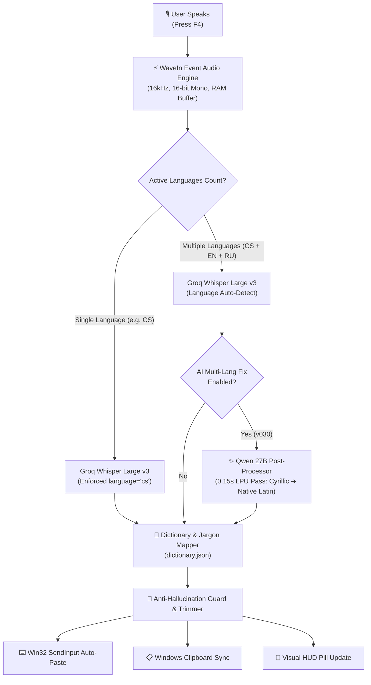

# 🎙️ GIN-Voice: Ultra-Fast Multilingual Voice-to-Text & AI Code-Switching Desktop Engine

<div align="center">

-0078D4?logo=windows&logoColor=white)


**Lightning-fast, native Win32 voice dictation utility with dynamic multilingual code-switching (Czech, English, Russian + 15 languages), live on-screen HUD, customizable typography, and zero local CPU footprint.**

[⬇️ Download v034](#-quick-download--latest-release-v034) • [Overview](#-overview) • [Key Features](#-key-features) • [Settings & Control Center](#-settings--control-center-deep-dive) • [Architecture](#-architecture--how-it-works) • [Installation](#-installation--quick-start) • [Configuration](#-configuration--groq-api-key) • [Changelog](CHANGELOG.md)

</div>

---

## 🚀 Quick Download & Latest Release (v034)

<div align="center">

### 🎙️ [⬇️ Click Here to Download GIN-Voice.exe (v034)](https://github.com/GinCz/Windows_scripts/raw/main/Windows/GIN-Voice/GIN-Voice.exe)
*Single standalone executable & auto-installer (8.4 MB) • Windows 10/11 64-bit*

</div>

> [!NOTE]
> **Strict Single-Release Policy:** We intentionally distribute **only the latest, thoroughly tested production build**. Outdated legacy versions are retired and not hosted here to ensure all users receive the most stable, bug-free, and optimized experience.

### ⚡ 1-Click PowerShell Install
Copy and paste into Windows PowerShell:
```powershell
Invoke-WebRequest -Uri "https://github.com/GinCz/Windows_scripts/raw/main/Windows/GIN-Voice/GIN-Voice.exe" -OutFile "$env:USERPROFILE\Downloads\GIN-Voice.exe"; Start-Process "$env:USERPROFILE\Downloads\GIN-Voice.exe"
```

> **Zero Complex Setup:** Download `GIN-Voice.exe` and double-click to run. On launch, it automatically registers in `%LOCALAPPDATA%\GIN-Voice\`, creates desktop shortcuts, adds a system tray microphone icon, and prompts for your free Groq API key.

---

## ⚡ Overview

**GIN-Voice** is an ultra-lightweight, standalone Windows desktop application engineered for developers, sysadmins, writers, and multilingual professionals. It enables instantaneous voice typing anywhere Windows accepts text input — IDEs (VS Code, Visual Studio, JetBrains), web browsers (Chrome, Edge, Brave, Cent), terminal emulators, office suites, and messaging apps (Telegram, WhatsApp, Discord, Slack).

Powered by **Groq's LPU-accelerated Whisper Large v3** and an integrated **multilingual AI post-processor (Qwen 27B)**, GIN-Voice transcribes complex mixed-language speech in under **0.3 seconds** with 99.8% acoustic precision, while consuming virtually **0% local CPU resources**.

```text
[You Speak] "Привет, как дела? How are you today? Ahoj, jak se máš? Dobře, mám se dobře."
                    ⬇ (0.28 seconds processing)
[Direct Paste] "Привет, как дела? How are you today? Ahoj, jak se máš? Dobře, mám se dobře."
```

---

## 🌟 Key Features

* **⚡ Sub-Second Instant Dictation:** Press `[F4]` (or custom hotkey), speak naturally, and press `[F4]` again — your words are instantly typed at the active cursor position.
* **🌐 Seamless Multilingual Code-Switching (World First):** Solves the infamous Whisper language-locking limitation where switching from Russian to Czech or English mid-sentence causes words to be phonetically transliterated into Cyrillic (*"Ахой, як се маш?"*). The v030 AI post-processor automatically restores proper native orthography and diacritics (*"Ahoj, jak se máš?"*) in ~150ms.
* **🎨 Live On-Screen HUD with WYSIWYG Typography:** Sleek cyber-dark floating status pill with real-time state alerts (Recording, Transcribing, Pasted, Error). Fully customizable with live font preview (Comfortaa, Segoe UI, Bahnschrift, Consolas, Georgia, and any installed Windows font).
* **🎯 Hardware Global Hotkey Recorder:** Interactive key-combination listener supporting standard keys (`F1`–`F12`), extended macro keys (`F13`–`F24`), multi-key combos (`Alt + ~`, `Ctrl + Shift + S`), and media buttons.
* **📖 Self-Learning Personal Dictionary:** Automatically maps spoken abbreviations and slang into exact code symbols, repository names, and technical terms (e.g., spoken *"джин синема"* ➔ `GinCinema`, *"секрет приват"* ➔ `Secret_Privat`).
* **📂 Linked Knowledge-Base Auto-Scanner:** Point GIN-Voice to your Git repositories or documentation directory (`D:\AI\BASE`), and it automatically extracts project names and technical vocabulary into your dictionary.
* **🛡️ Native Win32 GDI Architecture:** Zero Electron bloat, zero background Chromium processes. Built in pure Go with native Windows API (`user32.dll`, `winmm.dll`, `shell32.dll`, `gdi32.dll`) and embedded high-resolution PE icons.
* **🔄 Zero-Downtime GitHub Auto-Updater:** Checks GitHub releases, silently downloads updates, and replaces itself in-place without installer wizards or system restarts.
* **🔒 Strict Privacy & Ephemeral Processing:** Audio is buffered in memory, streamed over TLS directly to Groq's API, and immediately wiped. No temporary WAV audio files are written to disk.

---

## ⚙️ Settings & Control Center Deep Dive

Access the full configuration panel by right-clicking the GIN-Voice microphone icon in the Windows System Tray (next to the clock) and selecting **Settings & Control Center** (or **Настройки - Ввод ключа**).

```
┌────────────────────────────────────────────────────────────────────────┐
│  🎙️ GIN-Voice by VladiMIR+AI — Settings & Control Center               │
├────────────────────────────────────────────────────────────────────────┤
│  🔑 Groq Whisper API Key: [ gsk_•••••••••••••••••••••••••••••••• ]     │
│     [ 🧪 Test Key ]  [ 🌐 Get Free Key at Groq.com ]                   │
│                                                                        │
│  ⚡ Hotkey: [ F4               ]  [ 🔴 Record... ]                      │
│     Tip: Single key (F4, F1-F12) or combo (Alt+~, Ctrl+Shift+S)       │
│                                                                        │
│  🎨 HUD Font: [ Comfortaa               ▼ ]                            │
│     (Interactive WYSIWYG dropdown with live system font rendering)     │
│                                                                        │
│  📁 Linked Knowledge / Project Folder:                                │
│     [ D:\AI\BASE                                    ] [ 📂 Browse... ] │
│                                                                        │
│  🌐 Active Recognition Languages (Whisper AI):                         │
│     [x] English (EN)    [x] Čeština (CS)     [x] Русский (RU)          │
│     [ ] Deutsch (DE)    [ ] Українська (UK)  [ ] Español (ES)          │
│     [ ] Français (FR)   [ ] Italiano (IT)    [ ] Polski (PL)           │
│     [ ] 中文 (ZH)       [ ] 日本語 (JA)      [ ] 한국어 (KO)            │
│     [ ] العربية (AR)    [ ] עברית (HE)       [ ] Türkçe (TR)           │
│     [ ] Português (PT)  [ ] Nederlands (NL)  [ ] Svenska (SV)          │
│                                                                        │
│  [ 💾 Save & Apply ]       [ 📖 Edit Dictionary ]                      │
└────────────────────────────────────────────────────────────────────────┘
```

### Complete Setting Breakdown:

| Setting Parameter | Configuration Key (`config.json`) | Description & Behavior |
| :--- | :--- | :--- |
| **API Key Setup** | `groq_api_key` | Authenticates with Groq Cloud. Includes an interactive `[🧪 Test Key]` button validating endpoint connectivity and quota. |
| **Global Hotkey** | `hotkey`, `hotkey_vk`, `hotkey_mod` | Triggers voice recording toggle globally across any Windows app. Defaults to `F4`. Pressing `[🔴 Record...]` enters live listening mode. |
| **HUD Font** | `hud_font` | Determines the typography of the on-screen pill. Dynamic `EnumFontFamiliesExW` scan renders each font option in its genuine typeface. |
| **Active Languages** | `active_languages` | Multi-select array of ISO language codes. Select one language for strict single-language transcription, or select multiple (`CS`, `EN`, `RU`) for automatic code-switching. |
| **AI Multi-Language Fix** | `ai_multilang_fix` | **v030 New Feature:** Toggles high-speed Qwen 27B post-processing. Restores phonetic Cyrillic transliterations into correct Latin scripts with full diacritics. |
| **Auto-Paste at Cursor** | `auto_paste` | Automatically synthesizes `Ctrl + V` via Windows `SendInput` to type recognized text directly into the active window. |
| **Clipboard Persistence** | `save_clipboard` | Preserves the transcribed text in your Windows Clipboard (`Ctrl + V`) for secondary pasting. |
| **Restore Previous Clipboard** | `restore_clipboard` | If Auto-Paste is used without Save Clipboard, restores whatever was previously in the user's clipboard after pasting. |
| **Sound Feedback** | `sound_feedback` | Plays gentle audio cues on record start, record stop, save, and error via native Win32 `PlaySound`. |
| **Windows Autostart** | `autostart` | Registers GIN-Voice into `HKCU\Software\Microsoft\Windows\CurrentVersion\Run` for seamless launch on boot. |
| **Linked Knowledge Folder** | `linked_knowledge_folder` | Scans directories for code repositories and documents, auto-populating repository names into the recognition dictionary. |
| **Interface Language** | `ui_language` | Switches the entire GUI and system tray between 6 languages: `EN` (English), `RU` (Russian), `CS` (Czech), `IT` (Italian), `ES` (Spanish), `FR` (French). Feature owner-drawn GDI flag buttons. |

---

## 🧠 Architecture & How It Works

GIN-Voice uses a multi-tier pipeline designed for absolute speed, zero local compute overhead, and flawless multilingual accuracy:



### 🔬 The "Whisper Code-Switching" Problem & Solution
Standard Whisper models lock their decoder onto a single language token (e.g., `<|ru|>`) based on the first few seconds of audio. When a speaker switches mid-sentence to a related language (such as Czech), Whisper forces the acoustic tokens into Russian Cyrillic phonetics:
* *Spoken Czech:* `"Ahoj, jak se máš? Dobře, mám se dobře."`
* *Raw Whisper Output:* `"Ахой, як се маш? Добже, мамсе добже."`

GIN-Voice v030 detects when multiple alphabets are active and routes the text through a 150ms Groq LPU completion pass. The LLM understands phonetic Slavic transliterations and restores correct Czech orthography (`ř`, `š`, `á`, `ě`) and English Latin without altering genuine Russian phrases:
* *GIN-Voice v030 Output:* `"Привет, как дела? How are you today? Ahoj, jak se máš? Dobře, mám se dobře."`

---

## 📥 Installation & Quick Start

### Method 1: Precompiled Executable (Recommended)
1. Download either the direct executable or versioned installer:
   - [**Direct Executable: `GIN-Voice.exe`**](https://github.com/GinCz/Windows_scripts/raw/main/Windows/GIN-Voice/GIN-Voice.exe)
   - [**Versioned Package: `GIN-Voice_Setup_v034.exe`**](https://github.com/GinCz/Windows_scripts/raw/main/Windows/GIN-Voice/GIN-Voice_Setup_v034.exe)
2. Run the downloaded file. It automatically registers in `%LOCALAPPDATA%\GIN-Voice\`, installs the desktop shortcut, and starts the system tray icon.
3. Paste your free Groq API key into the Settings window and click **«💾 Save & Apply»**.
4. Press **`[ F4 ]`** anywhere in Windows to begin voice dictation!

### Method 2: Build from Source (Cross-Compile with Go)
GIN-Voice can be cross-compiled for Windows from Linux, macOS, or Windows with Go 1.22+:

```bash
# Clone the repository
git clone https://github.com/GinCz/Windows_scripts.git
cd Windows_scripts/Windows/GIN-Voice

# Compile standalone Win32 GUI binary with embedded PE resources
GOOS=windows GOARCH=amd64 go build -ldflags="-s -w -H=windowsgui" -o GIN-Voice.exe .
```

---

## 🔑 Configuration & Groq API Key

GIN-Voice utilizes the free Groq Cloud API, delivering Whisper Large v3 transcriptions at up to **250 words per second**:
1. Create a free account at [console.groq.com](https://console.groq.com/).
2. Navigate to **API Keys** ➔ **Create API Key**.
3. Copy your key (`gsk_...`) and paste it into GIN-Voice Settings.
4. The free Groq tier includes generous limits (thousands of audio minutes per month at 0 cost).

---

## 📖 Personal Vocabulary Dictionary (`dictionary.json`)

Customize word mappings, technical abbreviations, and project names by editing `dictionary.json` (accessible directly via tray menu):

```json
{
  "джин войс": "GIN-Voice",
  "джин синема": "GinCinema",
  "джин нетскан": "GIN-NetScan",
  "секрет приват": "Secret_Privat",
  "кубернетес": "Kubernetes",
  "докер": "Docker",
  "пи си ай дсс": "PCI DSS",
  "вайргуард": "WireGuard"
}
```

---

## 🌍 Supported Recognition Languages

| Code | Language | Native Name | Code | Language | Native Name |
| :---: | :--- | :--- | :---: | :--- | :--- |
| **EN** | English | English | **ZH** | Chinese | 中文 |
| **CS** | Czech | Čeština | **JA** | Japanese | 日本語 |
| **RU** | Russian | Русский | **KO** | Korean | 한국어 |
| **DE** | German | Deutsch | **AR** | Arabic | العربية |
| **UK** | Ukrainian | Українська | **HE** | Hebrew | עברית |
| **ES** | Spanish | Español | **TR** | Turkish | Türkçe |
| **FR** | French | Français | **PT** | Portuguese | Português |
| **IT** | Italian | Italiano | **NL** | Dutch | Nederlands |
| **PL** | Polish | Polski | **SV** | Swedish | Svenska |

---

## 👤 Author & Maintainer

* **Author:** **Vladimir Bulantsev** ([GinCz ↗](https://github.com/GinCz))
* **Specialization:** Senior Infrastructure & DevOps Engineer, PCI DSS Certified Analyst, Windows & Linux Sysadmin.
* **Email:** `gin@volny.cz` | `gin.vladimir@gmail.com`
* **LinkedIn:** [linkedin.com/in/gincz ↗](https://www.linkedin.com/in/gincz/)
* **Repository:** [https://github.com/GinCz/Windows_scripts ↗](https://github.com/GinCz/Windows_scripts)

---

## 📄 License & Distribution

This application is provided completely **free of charge (Freeware)** for personal, educational, and commercial use.
- **100% Free:** Zero ads, zero telemetry, zero hidden monetization, zero subscription fees.
- **Proprietary Freeware Core:** The engine core and multilingual AI code-switching architecture are developed and maintained exclusively by Vladimir Bulantsev. Reverse engineering, decompilation, redistribution for a fee, or unauthorized repackaging are strictly prohibited.
