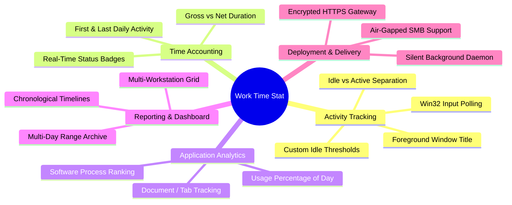

# Work Time Stat — Features & Functional Capabilities

[← Back to Main Portfolio](README.md) &nbsp;•&nbsp; [Technical Overview](TECHNICAL_OVERVIEW.md) &nbsp;•&nbsp; [Installation](INSTALLATION.md) &nbsp;•&nbsp; [Pricing](PRICING.md) &nbsp;•&nbsp; [Security](SECURITY.md)

---

## 📌 Verified Functional Architecture

Every capability listed below is confirmed and verified directly within the **Work Time Stat** engineering codebase. We do not advertise hypothetical or unverified features.

---

## 1. Employee Computer Activity Monitoring

- **Precision Win32 Input Sampling:** The endpoint agent continuously polls low-level OS input events via native `GetLastInputInfo` Win32 API calls at customizable intervals (default: 5 seconds).
- **Foreground Context Detection:** Identifies the exact application and window currently in focus using `GetForegroundWindow` and `GetWindowText` APIs.
- **Silent & Invisible Operation:** Operates without any taskbar icons, system tray notifications, popups, or user-facing windows, preventing distractions or operational interference.
- **Single-Instance Enforcement:** Embedded process watchdog terminates redundant instances, ensuring strictly one active monitoring process per machine.

---

## 2. Working Time Statistics & Presence Accounting

- **First & Last Activity Detection:** Automatically logs the exact time of the user's initial interaction in the morning and final activity in the evening.
- **Active Working Time:** Tracks continuous minutes and hours spent interacting with software applications.
- **Idle & Inactivity Tracking:** Separates periods when the employee is away from the workstation, in meetings, or on breaks.
- **Customizable AFK/Idle Thresholds:** Administrative setting to define the inactivity threshold (e.g. 30 seconds to 3 minutes) before flagging a session as idle.
- **Gross vs. Net Work Hours:** Provides executives with total elapsed workstation time alongside pure active business engagement.

---

## 3. Application Usage & Process Analytics

- **Per-Application Duration Breakdown:** Computes the exact time spent in each distinct software application throughout the day.
- **Window Title & Document Context:** Captures specific document names, active spreadsheets, CRM tickets, or web tabs to provide context on the work being performed.
- **Relative Share Analysis:** Calculates each application's percentage share against the employee's total active workday.
- **Organization-Wide Software Ranking:** Aggregates and ranks the most-used corporate applications across all teams and departments.
- **Process Noise Filtering:** Automatically handles system services, screen savers, and background utility processes to maintain clean business metrics.

---

## 4. Centralized Monitoring Dashboard

- **Single-Pane Management Console:** Modern dark-themed web interface accessible from desktop and tablet browsers.
- **Real-Time Workstation Status Badges:**
  - 🟢 **Active:** User currently interacting with business applications.
  - 🟡 **Idle / Away:** Workstation active but no keyboard/mouse input detected for over threshold duration.
  - ⚪ **Offline:** Workstation turned off, disconnected, or outside office hours.
- **Interactive Multi-Day Archive:** Instant date filters:
  - *Today*
  - *Yesterday*
  - *Last 3 Days*
  - *Last 7 Days*
  - *Last 30 Days*
  - *Custom Date Range Selection*
- **Visual Activity Timelines:** Interactive chronological heatmaps showing the progression of work, breaks, and software switches from morning to evening.

---

## 5. Administrative Management & Custom Deployment

- **Canonical Workstation & User Mapping:** Allows assigning friendly employee names, departmental roles, and workstation numbers to hardware hostnames.
- **Local Network (Air-Gapped) Mode:** Fully operational in restricted corporate LANs by writing and reading aggregated telemetry directly from a secured SMB network share.
- **Secure Cloud Gateway Mode:** Supports multi-branch and remote setups by streaming encrypted payloads over HTTPS REST endpoints.
- **Local Resilience Buffering:** Endpoints buffer telemetry locally in `ProgramData` during network outages, transmitting complete historical datasets once connectivity is restored.
- **Zero Heavy Database Dependencies:** Designed with lightweight file-based data structures and fast in-memory aggregation, eliminating the cost and maintenance overhead of large SQL clusters.

---

[← Return to Main Page](README.md) &nbsp;•&nbsp; [Explore Technical Architecture →](TECHNICAL_OVERVIEW.md)

