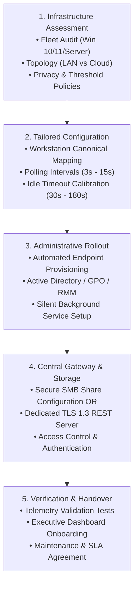

# Work Time Stat — Deployment Model & Installation Procedures

[← Back to Main Portfolio](README.md) &nbsp;•&nbsp; [Features](FEATURES.md) &nbsp;•&nbsp; [Technical Overview](TECHNICAL_OVERVIEW.md) &nbsp;•&nbsp; [Pricing](PRICING.md) &nbsp;•&nbsp; [Security](SECURITY.md)

---

## 📌 Administrative Delivery Model

> ### ⚠️ Notice Regarding Public Availability
> **Work Time Stat is not distributed as a public self-service installer.**  
> Each installation is performed individually by an administrator. Deployment is tailored to the customer's infrastructure, network environment, security requirements, and business needs.  
> Installation, configuration, integration, and maintenance arrangements are discussed individually.

Unlike mass-market monitoring applications that bundle generic bloatware or cloud dependencies, Work Time Stat is deployed as a **custom-engineered solution**. This ensures complete compatibility with the client's corporate network topology, operating systems, and data retention policies.

---

## 🛠️ Typical Professional Rollout Lifecycle

---

## 1. Stage 1: Preliminary Environment Assessment
Prior to deployment, our engineering team conducts an initial review with the customer's IT leadership:
- **Workstation Fleet Audit:** Verification of endpoint counts, hardware architectures (x64 / x86), and Windows operating system versions.
- **Network Topology Review:** Deciding between **Mode A (On-Premise Air-Gapped LAN)** and **Mode B (Dedicated HTTPS REST Gateway)**.
- **Policy Definition:** Aligning on business hours, employee aliases, departmental hierarchies, and idle time thresholds.

---

## 2. Stage 2: Custom Configuration & Hardening
The agent and dashboard are tailored specifically for the customer's operational parameters:
- **Canonical Identity Mapping:** Pre-populating configuration maps so computer hostnames automatically resolve to employee names and departments.
- **Timing Parameters:** Configuring polling frequencies, network push intervals, and buffer thresholds.
- **Security Hardening:** Provisioning unique API tokens, directory permissions, and data isolation controls.

---

## 3. Stage 3: Controlled Administrative Deployment
Endpoint deployment is executed with zero user interruption using standard administrative tooling:
- **Active Directory Group Policy (GPO):** Silent installation and startup configuration pushed across corporate domain computers.
- **Microsoft Intune / RMM:** Deployed remotely through corporate Endpoint Management platforms.
- **Targeted Administrative Scripts:** 1-click administrative setup for non-domain workgroup environments.
- **Self-Healing Background Task:** Configured as a Windows Scheduled Task or background service with automatic recovery upon system restart.

---

## 4. Stage 4: Central Storage & Dashboard Setup
- **On-Premise LAN:** Setup of a secured internal network folder with access control lists (ACLs) restricting access exclusively to the administrative monitoring service and designated management users.
- **Dedicated Cloud Gateway:** Provisioning of a dedicated Linux or Windows gateway server equipped with automated SSL/TLS certificate renewal, reverse proxy, and IP filtering.

---

## 5. Stage 5: Handover, Executive Training & Support
- Full end-to-end telemetry verification across all endpoints.
- Executive briefing on dashboard navigation, filter usage, and interpretation of working time metrics.
- Establishing ongoing maintenance agreements, health audits, and service level agreements (SLA).

---

## 📩 Discussing a Custom Deployment

To arrange an initial technical consultation or discuss a deployment for your organization, please contact:

- 👤 **Lead Engineer:** Vladimir Bulantsev (@GinCz)
- ✉️ **Email:** [gin@volny.cz](mailto:gin@volny.cz)
- 💼 **LinkedIn:** [linkedin.com/in/gincz](https://www.linkedin.com/in/gincz/)
- 🐙 **GitHub Portfolio:** [github.com/GinCz](https://github.com/GinCz)

---

[← Return to Main Portfolio](README.md) &nbsp;•&nbsp; [View Pricing & Commercial Model →](PRICING.md)

