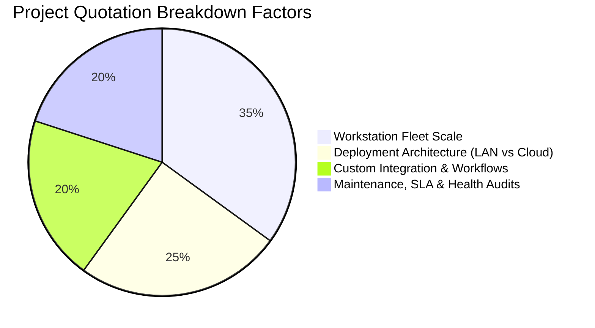

# Work Time Stat — Commercial Model & Custom Pricing

[← Back to Main Portfolio](README.md) &nbsp;•&nbsp; [Features](FEATURES.md) &nbsp;•&nbsp; [Technical Overview](TECHNICAL_OVERVIEW.md) &nbsp;•&nbsp; [Installation](INSTALLATION.md) &nbsp;•&nbsp; [Security](SECURITY.md)

---

## 💼 Custom Pricing Architecture

> ### 📋 Individually Evaluated Engagements
> **Work Time Stat** is provided exclusively as an individually deployed corporate solution. We do not use rigid per-seat subscription tiers or fixed public price tags, because every corporate environment has unique architectural, security, and administrative requirements.

Every project is evaluated individually. A customized quotation is provided after discussing the customer's requirements.

---

## 🔍 Key Factors Influencing Pricing

The quotation for an organization's deployment is determined based on the following key parameters:

1. **Workstation Fleet Scale:**
   - Small Office Fleet (5 – 25 endpoints)
   - Mid-Size Corporate Environment (25 – 100 endpoints)
   - Multi-Department Enterprise Network (100+ endpoints)

2. **Deployment Architecture Selection:**
   - **On-Premise Isolated LAN (SMB Mode):** Single-site deployment utilizing internal network infrastructure without external server costs.
   - **Dedicated Secure Cloud Gateway:** Provisioning, hardening, and maintaining an isolated dedicated Linux/Windows server with custom domain and TLS encryption.

3. **Custom Integration & Administrative Engineering:**
   - Mapping custom legacy software or specialized enterprise ERP/accounting software suites.
   - Configuring bespoke departmental reporting structures and custom data aggregation routines.
   - Automated deployment packaging tailored to client-specific RMM or Active Directory Group Policy structures.

4. **Service Level Agreement (SLA) & Maintenance:**
   - One-time turnkey deployment and handover.
   - Ongoing proactive maintenance, routine health audits, quarterly software updates, and engineering priority support.

---

## 📋 What Every Deployment Includes

Regardless of the engagement scale, every client receives:
- ✅ **100% Turnkey Engineering Delivery:** Complete setup of the monitoring agent and management dashboard.
- ✅ **Zero User Disruption:** Tested silent endpoint provisioning with low system overhead (<0.1% CPU).
- ✅ **Confidentiality & Data Sovereignty:** 100% of collected data resides exclusively on the client's private infrastructure or dedicated server.
- ✅ **Executive Dashboard Training:** Guided walkthrough of the web console, timeline interpretation, and reporting workflows.
- ✅ **Comprehensive Technical Documentation:** Environment-specific runbook detailing architecture, configurations, and administrative commands.

---

## 📩 Request a Custom Quotation

To schedule a discovery discussion and receive a formal commercial proposal for your business:

- 👤 **Lead Engineer:** Vladimir Bulantsev (@GinCz)
- 📍 **Location:** Prague, Czech Republic
- ✉️ **Direct Email:** [gin@volny.cz](mailto:gin@volny.cz)
- 💼 **LinkedIn Profile:** [linkedin.com/in/gincz](https://www.linkedin.com/in/gincz/)
- 🐙 **GitHub Engineering Portfolio:** [github.com/GinCz](https://github.com/GinCz)

---

[← Return to Main Portfolio](README.md) &nbsp;•&nbsp; [Review Security & Privacy Architecture →](SECURITY.md)

