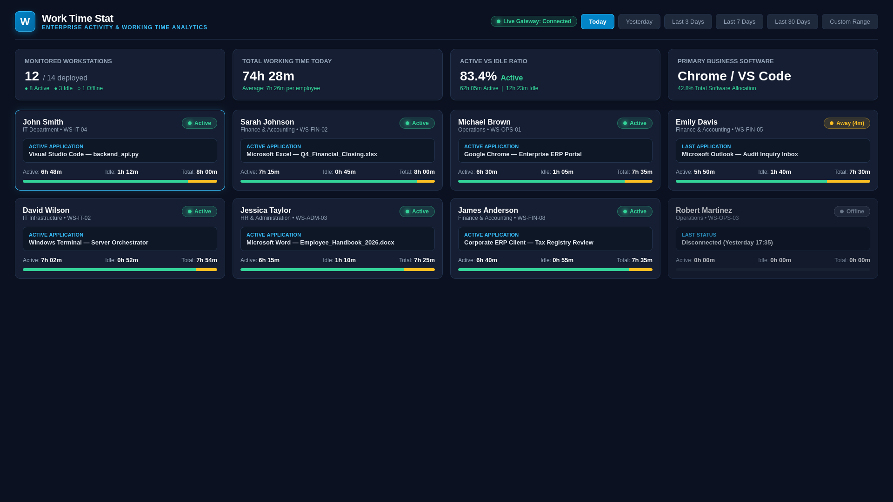
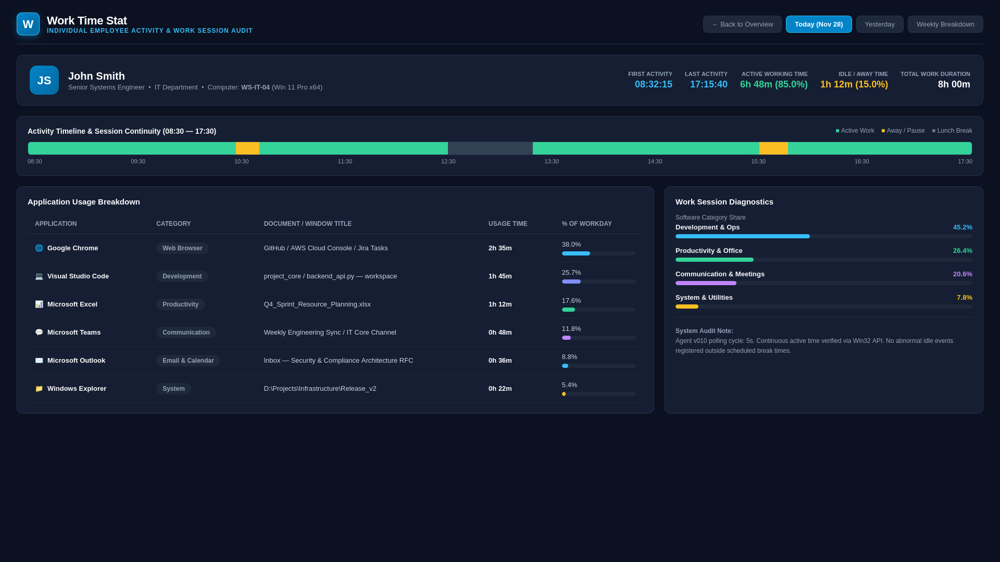
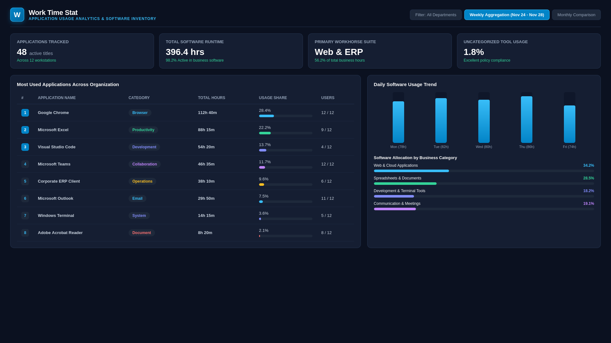
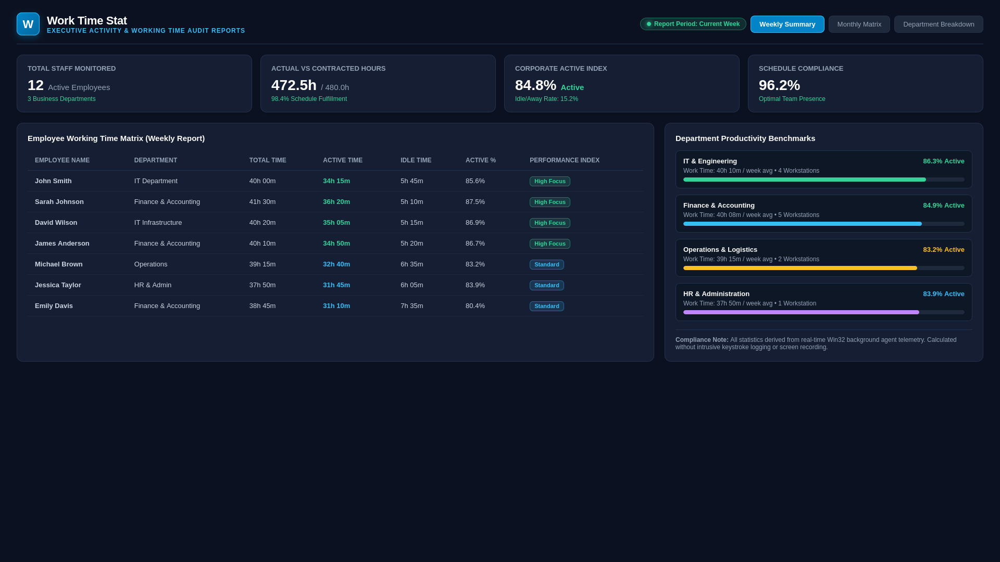
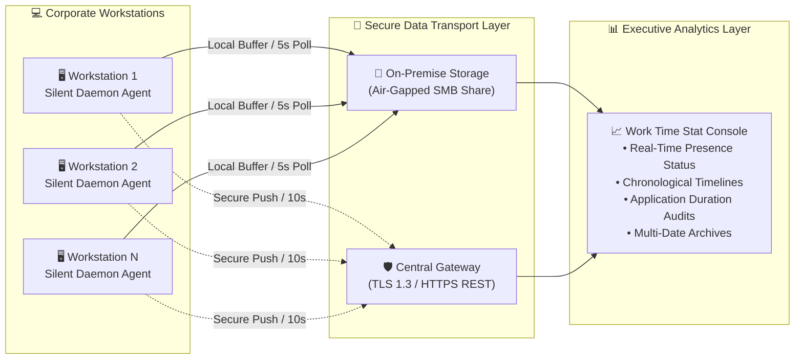

# Work Time Stat — Enterprise Employee Activity & Working Time Analytics

  

 

**A customizable employee computer activity monitoring and working time analytics solution designed for businesses.**

---

## 📌 Executive Overview

**Work Time Stat** is a customizable employee computer activity monitoring and working time analytics solution designed for businesses. The platform provides detailed insights into computer usage, application activity, working patterns, and productivity-related statistics.

Each deployment is individually configured and installed by an administrator according to the customer's infrastructure, operational requirements, and security policies.

Unlike off-the-shelf intrusive surveillance tools, **Work Time Stat** prioritizes **operational clarity, privacy compliance, and system efficiency**. It operates with ultra-low resource utilization (<0.1% CPU), requires zero workstation user interaction, and collects actionable operational data without invasive keylogging or screen recording.

---

## 🧭 Navigation & Documentation

- [📋 Comprehensive Features & Capabilities](FEATURES.md)
- [🏗️ Technical Architecture & System Overview](TECHNICAL_OVERVIEW.md)
- [⚙️ Deployment Model & Installation Procedures](INSTALLATION.md)
- [💼 Commercial Model & Custom Pricing](PRICING.md)
- [🛡️ Security Architecture & Privacy Safeguards](SECURITY.md)

---

## 🚀 Key Capabilities

- **Automated Working Time Accounting:** Automatically captures session start, finish, gross duration, net active work, and idle intervals without manual employee timecards.
- **Application & Process Telemetry:** Tracks foreground applications, document titles, and runtime durations to deliver complete transparency into enterprise software utilization.
- **Active vs. Idle Precision Analysis:** Uses native operating system input heuristics to differentiate between focused work and idle/away periods with customizable inactivity thresholds.
- **Dual Transport Topology:** Fully functional in both air-gapped internal corporate subnets (via local SMB replication) and distributed multi-site networks (via secure HTTPS REST gateways).
- **Executive Single-Pane Dashboard:** Modern, responsive dark-themed management console providing real-time team status badges, individual drill-downs, and historical analytics.
- **Custom Corporate Provisioning:** Workstation aliases, organizational departments, polling intervals, and retention windows tailored specifically for each client environment.

---

## 📊 System Visual Showcase

### 1. Central Executive Dashboard
A high-level view of all company workstations, live status badges (🟢 Active, 🟡 Idle/Away, ⚪ Offline), top utilized applications, and daily corporate KPIs.

### 2. Individual Employee Activity Profile
Granular audit of a single employee's workday (e.g. *John Smith*, IT Department): chronological activity timeline, active vs. idle ratio, and complete per-application usage breakdown.

### 3. Organization-Wide Application Statistics
Comprehensive inventory of all software executed across the company, ranked by total usage duration, percentage of enterprise work time, and cross-departmental distribution.

### 4. Executive Management & Compliance Reporting
Comparative team matrices, department productivity benchmarks, and schedule adherence metrics for weekly and monthly performance evaluations.

---

## ⚙️ How the System Operates

1. **Lightweight Agent Execution:** A background service daemon runs quietly on target Windows endpoints. It queries native Win32 API endpoints every 5 seconds to detect user activity and foreground window titles.
2. **Local Resiliency Buffer:** Telemetry is buffered in local non-volatile storage (`ProgramData`) to ensure zero data loss during corporate network disconnects.
3. **Transport & Aggregation:** Data is transmitted either to an internal corporate network share or through an encrypted HTTPS endpoint.
4. **Instant Analytical Rendering:** The management dashboard renders live workstation statuses, calculates idle vs. productive metrics, and provides historical data analysis across custom date windows (Today, Yesterday, Last 7 Days, Last 30 Days).

---

## 💻 Infrastructure Requirements

### Monitored Client Workstations
- **Operating System:** Windows 11, Windows 10, Windows 8.1, or Windows Server (both 64-bit and 32-bit architectures supported).
- **Environment:** Native Windows PowerShell runtime with standard Win32 API support.
- **Resource Footprint:** Less than 0.1% CPU consumption; less than 25 MB RAM.
- **User Permissions:** Administrative rights required once during initial setup; runs seamlessly in background under local system or standard user context.

### Central Collection & Management Layer
- **Local Network Deployment (Air-Gapped):** Standard Windows Server or Linux Samba SMB share with appropriate read/write share permissions.
- **Cloud / Distributed Deployment:** Linux or Windows host with HTTPS support and reverse proxy (Nginx / Cloudflare SSL).
- **Client Access:** Modern web browser (Chrome, Edge, Firefox, Safari) with responsive desktop and tablet support.

---

## 🤝 Individual Engagement & Inquiry

**Work Time Stat** is delivered exclusively as an engineered, individually deployed corporate solution. We do not provide generic public self-service downloads.

To schedule an architecture consultation, request a customized live demonstration, or receive an individual implementation quotation for your organization:

- 👤 **Lead Engineer:** Vladimir Bulantsev (@GinCz)
- 📍 **Location:** Prague, Czech Republic (Available for EU & Global Deployments)
- ✉️ **Direct Email:** [gin@volny.cz](mailto:gin@volny.cz)
- 💼 **LinkedIn:** [linkedin.com/in/gincz](https://www.linkedin.com/in/gincz/)
- 🐙 **GitHub Portfolio:** [github.com/GinCz](https://github.com/GinCz)

---

Work Time Stat &copy; 2026. Engineered by VladiMIR + AI · Custom Corporate Deployments.

