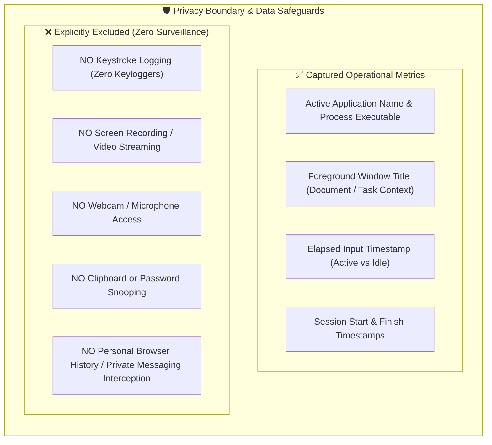

# Work Time Stat — Security & Privacy Architecture

[← Back to Main Portfolio](README.md) &nbsp;•&nbsp; [Features](FEATURES.md) &nbsp;•&nbsp; [Technical Overview](TECHNICAL_OVERVIEW.md) &nbsp;•&nbsp; [Installation](INSTALLATION.md) &nbsp;•&nbsp; [Pricing](PRICING.md)

---

## 🛡️ Security & Privacy Engineering Principles

**Work Time Stat** is engineered with a strict **non-intrusive monitoring posture**. The solution focuses on macro-level operational metrics and software usage duration rather than surveillance of private personal actions.

---

## 1. Controlled Administrative Deployment

- **Privileged Installation Control:** The monitoring daemon can only be provisioned and configured by authorized system administrators using elevated administrative permissions (Active Directory GPO, Microsoft Intune, or local administrative script).
- **Zero Standard User Manipulation:** Monitored users cannot modify polling intervals, disable logging, or inject false presence data without administrative privileges.
- **Dedicated Service Execution:** The agent executes quietly in the background under controlled system or scheduled task accounts.

---

## 2. Non-Intrusive Telemetry (Employee Privacy Safeguards)

To preserve employee trust and maintain a healthy workplace culture, Work Time Stat implements deliberate engineering constraints:
- **No Keystroke Logging:** The system does not capture or record individual keystrokes, protecting passwords, credentials, and personal typing.
- **No Screen Capture or Video Feeds:** The agent does not record desktop screens, stream video, or capture webcam feeds.
- **No Audio Surveillance:** Microphone and audio hardware are completely untouched.
- **Focus on Business Accountability:** Only the foreground window caption and process executable are recorded to measure time allocated to specific business applications.

---

## 3. Data Protection & Transmission Security

Depending on the customer's deployment architecture, data protection is enforced at multiple layers:

### On-Premise LAN Deployments (Mode A)
- **Subnet Isolation:** Telemetry data never leaves the organization's private local area network.
- **File System Permissions (ACLs):** The centralized storage directory is secured using Windows NTFS permissions and SMB access control lists, restricting read/write access strictly to the administrative service account and management personnel.
- **Air-Gapped Resiliency:** Zero outbound internet connections are generated, eliminating external attack vectors.

### Cloud Gateway Deployments (Mode B)
- **Encrypted Transmission:** All endpoint-to-gateway communication is transmitted over standard TLS 1.3 / HTTPS encryption.
- **API Token Authentication:** Endpoints authenticate against the gateway daemon using dedicated administrative tokens passed via HTTP authorization headers.
- **Network Filtering:** Central endpoints can be restricted via IP allowlisting, reverse proxies, and Cloudflare security controls.

---

## 4. Access Control & Management Visibility

- **Role-Based Web Access:** Access to the executive dashboard can be protected by administrative authentication, IP restriction, or corporate VPN access.
- **Data Sovereignty:** All gathered telemetry resides exclusively on the customer's chosen infrastructure (on-premise server or dedicated private cloud instance). We do not operate a shared multi-tenant SaaS cloud where customer data is co-mingled.
- **Configurable Retention Policies:** Data archive depth (7 days, 30 days, 90 days, or custom) is configured according to the customer's internal operational standards and storage capacity.

---

[← Return to Main Portfolio](README.md) &nbsp;•&nbsp; [Request Custom Deployment Consultation →](PRICING.md)

