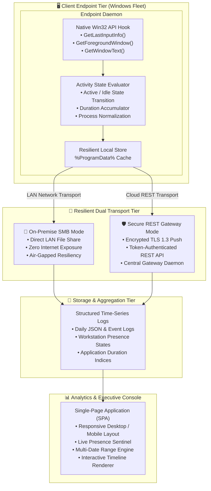

# Work Time Stat — Technical Architecture & Overview

[← Back to Main Portfolio](README.md) &nbsp;•&nbsp; [Features](FEATURES.md) &nbsp;•&nbsp; [Installation](INSTALLATION.md) &nbsp;•&nbsp; [Pricing](PRICING.md) &nbsp;•&nbsp; [Security](SECURITY.md)

---

## 🏗️ High-Level System Architecture

**Work Time Stat** is engineered with a modular, resilient multi-tier architecture designed to run reliably in both isolated corporate LANs and distributed enterprise networks.

---

## 1. Client Endpoint Agent Architecture

The client agent is designed for maximum stealth, operational stability, and minimal hardware consumption:

- **Native Windows API Integration:** Telemetry is gathered using compiled P/Invoke calls to core Win32 libraries (`user32.dll`, `kernel32.dll`):
  - `GetLastInputInfo`: Measures millisecond elapsed time since the user last interacted with the mouse or keyboard.
  - `GetForegroundWindow`: Retrieves the handle of the top-level active window.
  - `GetWindowText`: Captures the textual caption of the active window for document context.
- **Ultra-Low Resource Footprint:**
  - **CPU Utilization:** < 0.1% average CPU usage during continuous 5-second polling cycles.
  - **Memory Footprint:** Typically 15–25 MB working set.
  - **Disk I/O:** Batched local writes ensure negligible disk activity.
- **Process Supervision & Concurrency:** The agent enforces a strict single-instance mutex. Upon startup or scheduled invocation, any lingering or duplicate agent instances are automatically terminated.
- **Resilient Offline Buffering:** If the target SMB share or HTTPS gateway becomes unreachable due to network disruptions, the agent buffers telemetry locally on the workstation drive. Once connectivity is restored, all queued events are pushed without data loss.

---

## 2. Dual Data Transport Strategies

To accommodate diverse corporate security postures, Work Time Stat provides two primary deployment modes:

### Mode A: Air-Gapped / Isolated On-Premise LAN (SMB)
- **Concept:** Endpoints write telemetry directly to a secure network share located on an internal server.
- **Characteristics:**
  - 100% operational without external internet connectivity.
  - No external ports, proxies, or cloud servers required.
  - Executive dashboard can be executed locally from the shared directory via a direct file path or internal web server.

### Mode B: Encrypted Cloud / Multi-Site REST Gateway
- **Concept:** Endpoints transmit compressed JSON payloads to an administrative REST endpoint over TLS 1.3 / HTTPS.
- **Characteristics:**
  - Ideal for multi-branch organizations, remote workers, or centralized cloud management.
  - Secured via custom HTTP API authentication tokens.
  - Central server aggregates workstation logs and serves the executive dashboard via an encrypted web portal.

---

## 3. Data Processing & Aggregation

The data aggregation engine normalizes workstation telemetry into structured daily work sessions:

- **Canonical Hostname & User Resolution:** Resolves raw Windows computer names (e.g. `DESKTOP-8K21`, `PC-04`) to standardized employee identities, department groupings, and workstation codes.
- **Idle State Segmentation:** Sequences raw polling events into discrete chronological intervals:
  - *Active Interval:* Continuous input detected within the inactivity threshold.
  - *Idle Interval:* Time span where inactivity exceeds the threshold, tracking away time.
- **Application Grouping & Normalization:** Extracts application names, associates them with window titles, aggregates cumulative runtimes, and calculates percentage shares of total active time.

---

## 4. Presentation & Executive Web Interface

The executive console is built as a responsive, zero-dependency Single-Page Application (SPA):

- **Zero Heavy Framework Bloat:** Built with clean modern HTML5, CSS3 variables, and vanilla JavaScript for sub-second loading speed on any workstation or mobile browser.
- **Asynchronous Live Updates:** Automatically polls for workstation updates without requiring manual page refreshes.
- **Interactive Multi-Day Archive:** Dynamically loads historical datasets, allowing executives to inspect team performance across customizable time horizons (daily, weekly, monthly).
- **Responsive Visual Timelines:** Renders color-coded chronological timelines showing activity patterns throughout the working day.

---

[← Back to Main Portfolio](README.md) &nbsp;•&nbsp; [View Deployment & Installation Procedures →](INSTALLATION.md)

