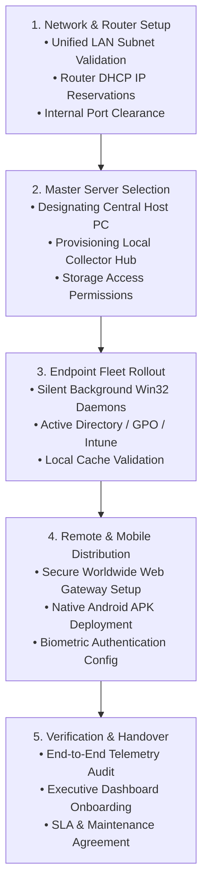

# Work Time Stat — Deployment Model & Installation Procedures

[← Back to Main Portfolio](README.md) &nbsp;•&nbsp; [Features](FEATURES.md) &nbsp;•&nbsp; [Technical Overview](TECHNICAL_OVERVIEW.md) &nbsp;•&nbsp; [Pricing](PRICING.md) &nbsp;•&nbsp; [Security](SECURITY.md)

---

## 📌 Administrative Delivery Model

> ### ⚠️ Notice Regarding Public Availability
> **Work Time Stat is not distributed as a public self-service installer.**  
> Each installation is performed individually by an administrator. Deployment is tailored to the customer's infrastructure, network environment, security requirements, and business needs.  
> Installation, configuration, integration, and maintenance arrangements are discussed individually.

Unlike mass-market monitoring applications that bundle generic bloatware or cloud dependencies, Work Time Stat is deployed as a **custom-engineered solution**. This ensures complete compatibility with the client's corporate network topology, operating systems, and data retention policies.

---

## 🛠️ Corporate Deployment Lifecycle

---

## 1. Stage 1: Network & Router Preparation

When monitoring multiple computers within an office, network cohesion is paramount:
- **Unified Network Subnet:** All monitored workstations must be grouped on a single corporate network (same local subnet or routed VLAN).
- **Router & Switch Configuration:**
  - Office routers must be configured with **DHCP static reservations** for all workstation MAC addresses and the designated master server to prevent IP drift.
  - Internal network traffic between endpoints and the master host must be unobstructed by internal desktop firewalls.

---

## 2. Stage 2: Designating the On-Premise Master Server

Exactly **one computer** in the local office fleet is chosen as the **Master Server**:
- **Selection Criteria:** A workstation or server with high uptime during business hours, adequate disk space for historical logs, and stable network connectivity.
- **Role:** Serves as the central collection hub, accumulating real-time telemetry from all other computers and maintaining the authoritative audit trail.
- **Data Repository:** Configured with structured file storage or internal HTTP listener with strict Windows ACL security permissions.

---

## 3. Stage 3: Controlled Endpoint Fleet Rollout

Endpoint deployment is executed with zero user interruption using standard administrative tooling:
- **Active Directory Group Policy (GPO):** Silent installation and startup configuration pushed across corporate domain computers.
- **Microsoft Intune / RMM:** Deployed remotely through corporate Endpoint Management platforms.
- **Targeted Administrative Scripts:** 1-click administrative setup for non-domain workgroup environments.
- **Self-Healing Background Task:** Configured as a Windows Scheduled Task or background service with automatic recovery upon system restart.

---

## 4. Stage 4: Worldwide Remote Management & Android APK Setup

Once the master server is aggregating local telemetry, distribution is established:
- **Global Remote Management:** For executives requiring oversight from outside the office, the master server is paired with a secured reverse proxy (Nginx / TLS 1.3), enabling access from **any location worldwide** over encrypted HTTPS.
- **Native Android APK Deployment:** The custom mobile application is installed on executive smartphones and tablets, featuring biometric fingerprint/PIN authentication, live pull-to-refresh, and theme customization (Day / Evening / Night).

---

## 5. Stage 5: Handover, Training & Maintenance

- Full end-to-end telemetry verification across all endpoints.
- Executive briefing on dashboard navigation, filter usage, and interpretation of working time metrics.
- Establishing ongoing maintenance agreements, health audits, and service level agreements (SLA).

---

## 📩 Discussing a Custom Deployment

To arrange an initial technical consultation or discuss a deployment for your organization, please contact:

- 👤 **Lead Engineer:** Vladimir Bulantsev (@GinCz)
- ✉️ **Email:** [gin@volny.cz](mailto:gin@volny.cz)
- 💼 **LinkedIn:** [linkedin.com/in/gincz](https://www.linkedin.com/in/gincz/)
- 🐙 **GitHub Portfolio:** [github.com/GinCz](https://github.com/GinCz)

---

[← Return to Main Portfolio](README.md) &nbsp;•&nbsp; [View Pricing & Commercial Model →](PRICING.md)

