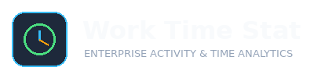
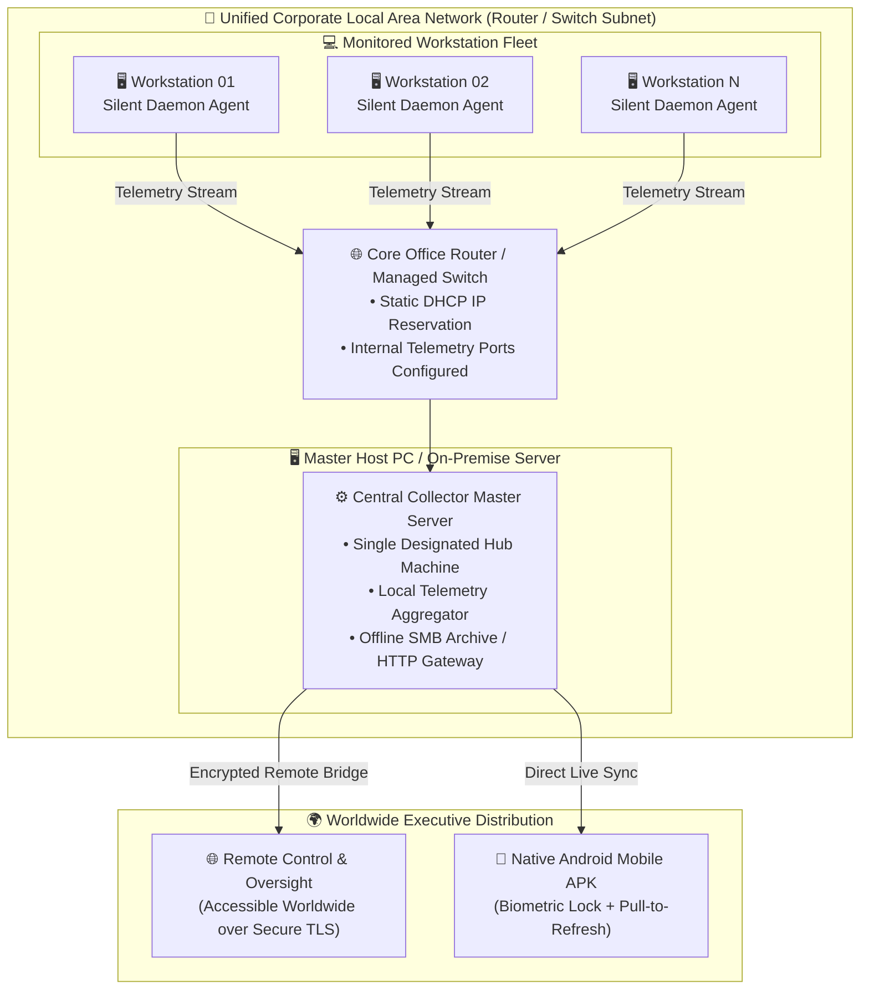
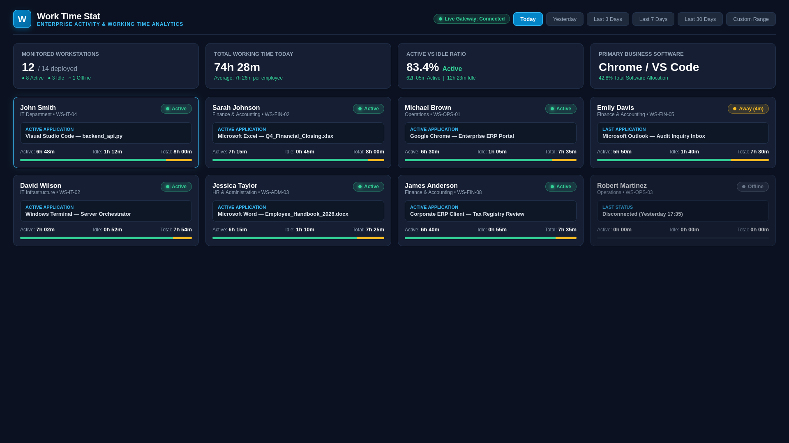
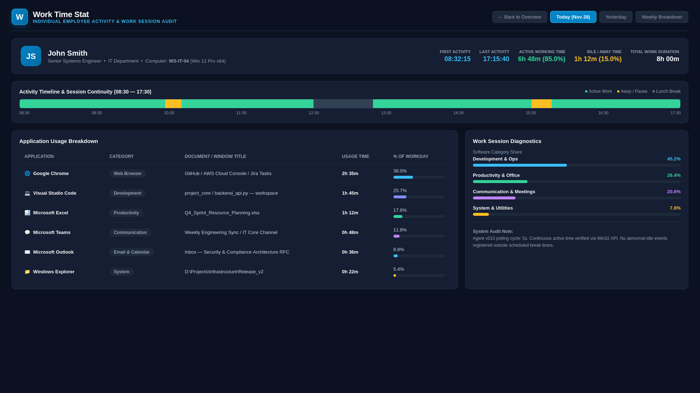
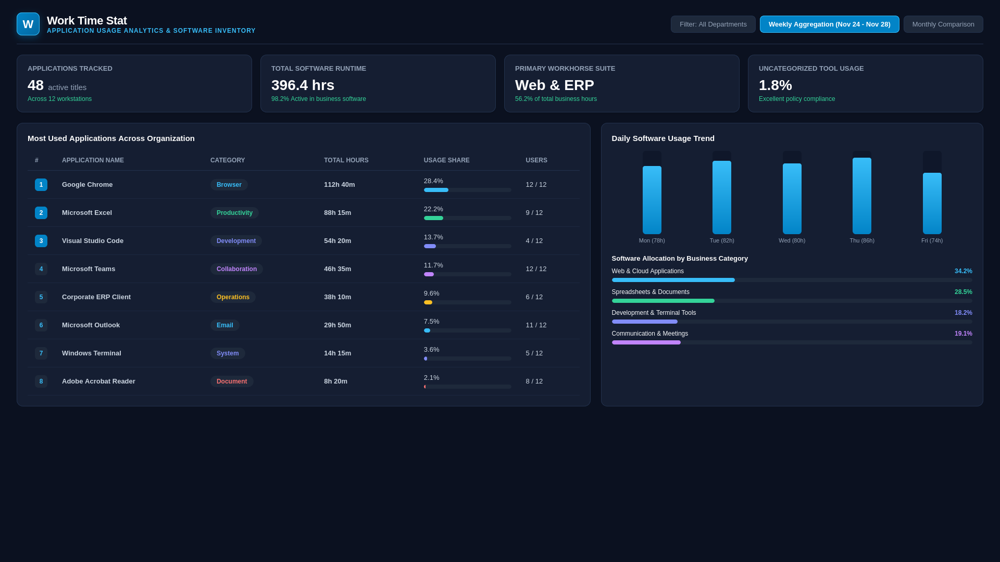
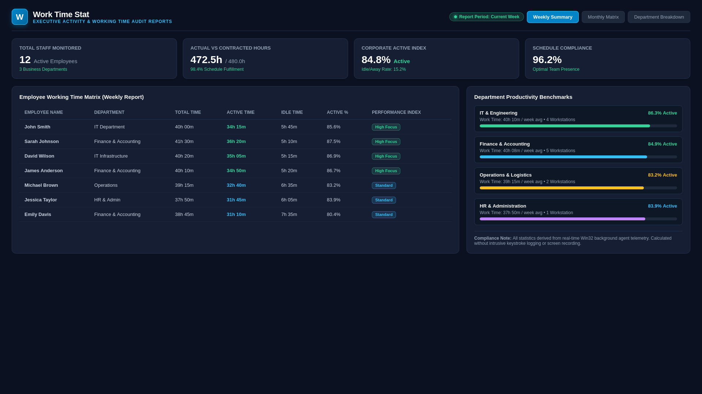

# Work Time Stat — Enterprise Employee Activity & Working Time Analytics

 

[← Back to Windows Suite](../README.md) &nbsp;•&nbsp; [Features](FEATURES.md) &nbsp;•&nbsp; [Technical Overview](TECHNICAL_OVERVIEW.md) &nbsp;•&nbsp; [Installation](INSTALLATION.md) &nbsp;•&nbsp; [Pricing](PRICING.md) &nbsp;•&nbsp; [Security](SECURITY.md)

 

-3DDC84?logo=android&logoColor=white)

 

**A customizable employee computer activity monitoring and working time analytics solution designed for businesses.**

---

## 📌 Executive Overview

**Work Time Stat** is a customizable employee computer activity monitoring and working time analytics solution designed for businesses. The platform provides detailed insights into computer usage, application activity, working patterns, and productivity-related statistics.

Each deployment is individually configured and installed by an administrator according to the customer's infrastructure, operational requirements, and security policies.

Unlike off-the-shelf intrusive surveillance tools, **Work Time Stat** prioritizes **operational clarity, privacy compliance, and system efficiency**. It operates with ultra-low resource utilization (<0.1% CPU), requires zero workstation user interaction, and collects actionable operational data without invasive keylogging or screen recording.

---

## 🧭 Navigation & Documentation

- [📋 Comprehensive Features & Capabilities](FEATURES.md)
- [🏗️ Technical Architecture & System Overview](TECHNICAL_OVERVIEW.md)
- [⚙️ Deployment Model & Installation Procedures](INSTALLATION.md)
- [💼 Commercial Model & Custom Pricing](PRICING.md)
- [🛡️ Security Architecture & Privacy Safeguards](SECURITY.md)

---

## 🚀 Key Capabilities

- **Unified Network & Master Server Architecture:** All monitored office workstations are grouped within a unified corporate network. A single designated computer serves as the **Master Collector Server**, gathering all workstation telemetry and distributing real-time analytics to executive remote dashboards worldwide and the native Android APK.
- **Tri-Mode Ergonomic Visual Engine (Day / Evening / Night):** Instant theme switching in settings:
  - ☀️ **Day (Light Mode):** Clean, crisp contrast tailored for bright office environments.
  - 🌇 **Evening (Warm Dusk Mode):** Soothing amber/warm tone reducing blue light strain during late afternoon hours.
  - 🌙 **Night (Deep OLED Dark Mode):** High-efficiency dark contrast for low-light management audits and mobile battery savings.
- **Automated Working Time Accounting:** Automatically captures session start, finish, gross duration, net active work, and idle intervals without manual employee timecards.
- **Application & Process Telemetry:** Tracks foreground applications, document titles, and runtime durations to deliver complete transparency into enterprise software utilization.
- **Active vs. Idle Precision Analysis:** Uses native operating system input heuristics to differentiate between focused work and idle/away periods with customizable inactivity thresholds.
- **Cross-Platform Access:** Native executive access via responsive modern web browsers and dedicated Android APK with biometric fingerprint/PIN authentication and real-time pull-to-refresh.

---

## 🌐 Network Topology & Master Server Setup

In multi-workstation office environments, the infrastructure operates under a structured network model:

1. **Unified Network Requirement:** All monitored computers must be connected within the same local corporate network (or routed office VLAN). The corporate router and network switches must be properly configured with static IP reservations or local DHCP mappings to ensure reliable inter-node communication.
2. **Designated Master Server:** Exactly **one computer** in the local network is chosen as the **Master Server**. This machine acts as the authoritative aggregator, receiving telemetry streams from all client workstations.
3. **Global Distribution & Android APK:** From this central master server, monitoring is securely distributed:
   - **Worldwide Remote Management:** Executives can view live office presence, productivity graphs, and detailed application logs from anywhere in the world.
   - **Native Android APK:** Real-time mobile visibility via Android smartphone/tablet app with biometric protection.

---

## 📊 System Visual Showcase

### 1. Central Executive Dashboard
A high-level view of all company workstations, live status badges (🟢 Active, 🟡 Idle/Away, ⚪ Offline), top utilized applications, and daily corporate KPIs.

### 2. Individual Employee Activity Profile
Granular audit of a single employee's workday (e.g. *John Smith*, IT Department): chronological activity timeline, active vs. idle ratio, and complete per-application usage breakdown.

### 3. Organization-Wide Application Statistics
Comprehensive inventory of all software executed across the company, ranked by total usage duration, percentage of enterprise work time, and cross-departmental distribution.

### 4. Executive Management & Compliance Reporting
Comparative team matrices, department productivity benchmarks, and schedule adherence metrics for weekly and monthly performance evaluations.

---

## 🎨 Tri-Mode Ergonomic Visual Engine

Located directly in the Settings modal (`⚙️`) alongside multilingual localization (English, Russian, Ukrainian, Czech):

| Theme Mode | Visual Palette | Recommended Environment | Key Benefit |
| :--- | :--- | :--- | :--- |
| ☀️ **Day (Light)** | `#f1f5f9` background, `#ffffff` cards, crisp `#0f172a` text | Bright corporate offices, daylight hours | Maximum readability under high ambient light |
| 🌇 **Evening (Warm Dusk)** | `#18121e` plum background, `#261b2d` warm cards, `#fdf4ff` text | Sunset, late afternoon, dim lighting | Reduces blue light eye strain and fatigue |
| 🌙 **Night (Deep Dark)** | `#0f172a` slate background, `#1e293b` cards, `#f8fafc` text | Night shifts, executive late-hour audits | Optimal contrast, minimal glare, mobile battery savings |

Both the browser-based dashboard and the native Android APK synchronize theme settings instantly and persist user preferences across sessions.

---

## 💻 Infrastructure Requirements

### Monitored Client Workstations
- **Operating System:** Windows 11, Windows 10, Windows 8.1, or Windows Server (both 64-bit and 32-bit architectures supported).
- **Environment:** Native Windows PowerShell runtime with standard Win32 API support.
- **Resource Footprint:** Less than 0.1% CPU consumption; less than 25 MB RAM.
- **User Permissions:** Administrative rights required once during initial setup; runs seamlessly in background under local system or standard user context.

### Master Collector Server (Central Host PC)
- **Role:** Dedicated computer or server designated in the local office network to aggregate fleet telemetry.
- **Operating System:** Windows 10/11, Windows Server, or Linux (Debian / Ubuntu / Rocky).
- **Network Interface:** Static IP on the office subnet; router configured for internal telemetry traffic and external HTTPS gateway if remote access is required.

---

## 🤝 Individual Engagement & Inquiry

**Work Time Stat** is delivered exclusively as an engineered, individually deployed corporate solution. We do not provide generic public self-service downloads.

To schedule an architecture consultation, request a customized live demonstration, or receive an individual implementation quotation for your organization:

- 👤 **Lead Engineer:** Vladimir Bulantsev (@GinCz)
- 📍 **Location:** Prague, Czech Republic (Available for EU & Global Deployments)
- ✉️ **Direct Email:** [gin@volny.cz](mailto:gin@volny.cz)
- 💼 **LinkedIn:** [linkedin.com/in/gincz](https://www.linkedin.com/in/gincz/)
- 🐙 **GitHub Portfolio:** [github.com/GinCz](https://github.com/GinCz)

---

Work Time Stat &copy; 2026. Engineered by VladiMIR + AI · Custom Corporate Deployments.

