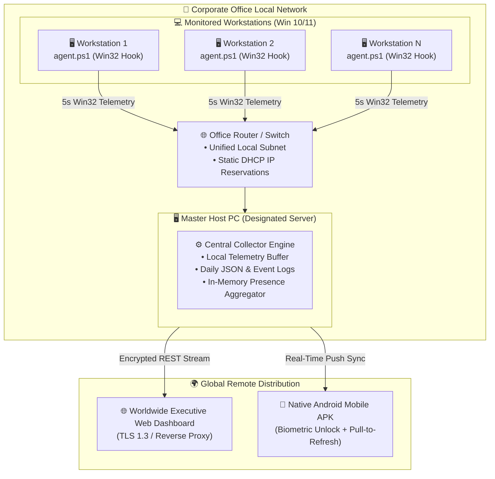

# Work Time Stat — Technical Architecture & Overview

<div align="center">

[← Back to Main Portfolio](README.md) &nbsp;•&nbsp; [Features](FEATURES.md) &nbsp;•&nbsp; [Installation](INSTALLATION.md) &nbsp;•&nbsp; [Pricing](PRICING.md) &nbsp;•&nbsp; [Security](SECURITY.md)

</div>

---

## 🏗️ High-Level System Architecture

**Work Time Stat** is engineered with a modular, resilient multi-tier architecture designed to run reliably in both isolated corporate LANs and globally accessible enterprise networks.



---

## 1. Network Topology & Router Requirements

In a corporate environment where multiple computers are monitored, the network infrastructure must adhere to a clean engineering standard:

- **Single Unified Subnet:** All monitored endpoints must reside within the same physical or virtual corporate network (single LAN subnet, e.g. `192.168.1.0/24`, or properly routed corporate VLANs).
- **Router & Switch Configuration:**
  - **Static DHCP Reservations:** Routers are configured with IP reservations or static bindings for all monitored workstations and the master server.
  - **Internal Firewall Permissions:** Local communication between workstations and the master host PC must be permitted on internal telemetry ports (SMB file sharing port 445 or internal HTTP port 8099).
- **Master Collector Server (Designated Host PC):**
  - Exactly **one computer** in the local office network is selected to act as the **Master Server**.
  - All workstations stream their telemetry to this designated machine.
  - The master server acts as the central data vault, aggregating daily work logs, calculating idle thresholds, and serving analytics to remote clients.

---

## 2. Global Remote Management & Android Mobile APK

From the central master server, monitoring is distributed across two primary interfaces:

### A. Worldwide Executive Web Dashboard
- Executives can securely log into the monitoring console from any location in the world.
- Protected by administrative token authentication, TLS 1.3 encryption, and optional IP allowlisting.
- Fully responsive across desktop workstations, laptops, and tablets.

### B. Native Android APK Application
- Custom Android mobile application designed for executive smartphones and tablets.
- **Biometric Security:** Fingerprint and PIN lock to ensure confidential access on personal devices.
- **Pull-to-Refresh:** Instant swipe-down gesture to trigger a live telemetry refresh across all office PCs.
- **Offline Cache:** Embedded local assets allow viewing historical logs even when traveling or temporarily disconnected.

---

## 3. Client Endpoint Agent Architecture

The client agent is designed for maximum stealth, operational stability, and minimal hardware consumption:

- **Native Windows API Integration:** Telemetry is gathered using compiled P/Invoke calls to core Win32 libraries (`user32.dll`, `kernel32.dll`):
  - `GetLastInputInfo`: Measures millisecond elapsed time since the user last interacted with the mouse or keyboard.
  - `GetForegroundWindow`: Retrieves the handle of the top-level active window.
  - `GetWindowText`: Captures the textual caption of the active window for document context.
- **Ultra-Low Resource Footprint:**
  - **CPU Utilization:** < 0.1% average CPU usage during continuous 5-second polling cycles.
  - **Memory Footprint:** Typically 15–25 MB working set.
  - **Disk I/O:** Batched local writes ensure negligible disk activity.
- **Process Supervision & Concurrency:** The agent enforces a strict single-instance mutex. Upon startup or scheduled invocation, any lingering or duplicate agent instances are automatically terminated.
- **Resilient Offline Buffering:** If the master server becomes temporarily unreachable, the agent buffers telemetry locally on the workstation drive (`%ProgramData%`). Once network connectivity is restored, all queued events are delivered without data loss.

---

## 4. Tri-Mode Ergonomic Theme Architecture

To maximize visual comfort and adapt to diverse ambient lighting conditions, Work Time Stat implements a dynamic CSS variable engine:

```css
/* Night Mode (Default Deep Dark) */
body.theme-night {
    --bg-main: #0f172a;
    --bg-card: #1e293b;
    --border: #334155;
    --text-main: #f8fafc;
    --text-muted: #94a3b8;
}

/* Day Mode (Crisp High-Contrast Light) */
body.theme-day {
    --bg-main: #f1f5f9;
    --bg-card: #ffffff;
    --border: #cbd5e1;
    --text-main: #0f172a;
    --text-muted: #64748b;
}

/* Evening Mode (Warm Dusk / Sunset) */
body.theme-evening {
    --bg-main: #18121e;
    --bg-card: #261b2d;
    --border: #4a3356;
    --text-main: #fdf4ff;
    --text-muted: #d8b4e2;
}
```

Themes are managed through `setTheme(theme)`, stored in `localStorage`, and exposed to the native Android bridge via JavaScript interface (`window.setTheme(theme)`), enabling instant visual synchronization across web and mobile.

---

<div align="center">

[← Back to Main Portfolio](README.md) &nbsp;•&nbsp; [View Deployment & Installation Procedures →](INSTALLATION.md)

</div>
